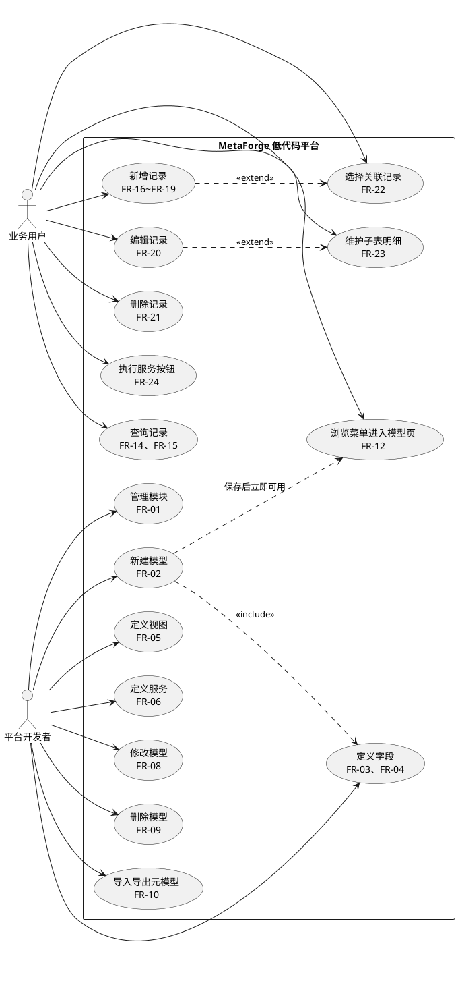

# 1 需求分析

> 组内成员：李奕铭（后端）、丘靖伟（前端）、马韶廷（文档）。

## 1.1 调查对象和方式

需求来自三处：课题原文的四条要求、小组内部的方案讨论、对两类用户的问卷访谈。

问卷分两份，每份 5 题，2026-11-14 至 11-15 在小组群内发放，要求按实际经历作答、每题一两句话：

- **问卷 A 平台开发者**：发给组内两位成员。两人都在课上用 IIDP（工业数字平台）以注解方式开发过 MES 案例，既有“作为开发者定义模型”的经验，也踩过编译、重启的坑。这份问卷回答的是“做平台的人需要什么”。
- **问卷 B 业务用户**：由负责文档的同学按课上使用 MES 案例的体验作答。这份问卷回答的是“用平台做出来的系统，使用者需要什么”。

调查方式为文字问卷加当场追问，回答原文照录在第 1.2 节，未做改写。与问卷同时收集了各人对所用技术的熟悉程度和预计工时，用于第 2 章的可行性分析。

## 1.2 需求调查表

| 题号 | 问题 | 回答人 | 回答原文 | 由此得到的需求编号 |
|---|---|---|---|---|
| A-1 | 让你在平台上加一个新业务对象（比如“供应商”），你希望从哪一步开始填？希望平台自动帮你做完哪些事？ | 丘靖伟（前端） | 希望只填「标识 + 显示名」这两样最少的，剩下的全自动：建表、增删改查接口、菜单、列表页、表单页都自动生成。我刷新一下页面，「供应商」就出现在菜单里、能直接用了，不用碰任何代码。 | FR-01、FR-02、FR-07、FR-27 |
| A-1 | 同上 | 李奕铭（后端） | 先选一个模块，填模型名和显示名，然后一个个加字段：标识、显示名、类型、要不要必填/唯一/默认值。保存之后希望平台自动把剩下的都做完——建好数据库表、给一份能直接用的列表页和表单页（不用我自己配视图）、菜单里自动出现、接口立刻就能调，不写一行代码也不重启。 | FR-01、FR-02、FR-05、FR-07、FR-27 |
| A-2 | 给“物料”加一个字段，你希望多久能用上？能接受重启系统或者重新编译吗？ | 丘靖伟（前端） | 希望保存后立刻生效，刷新页面就能用，几秒钟内。不能接受重启系统或重新编译——加个字段还要重启，那跟写代码没区别了，就失去低代码的意义了。 | FR-08、FR-26 |
| A-2 | 同上 | 李奕铭（后端） | 保存完刷新一下就要能用，不能接受重启，更不能重新编译。IIDP 就是注解写的，加个字段要改代码、编译、重启，一次好几分钟，调试的时候特别难受——这也是我们把模型定义改存成数据、运行时生效的直接原因。 | FR-08、FR-26 |
| A-3 | 定义字段的时候你希望有哪几种类型？哪些校验希望平台自动做？说一个你在 IIDP 上踩过的坑。 | 丘靖伟（前端） | 单行文本、多行文本、整数、小数、布尔、日期、日期时间、枚举、关联（多对一/一对多），这些就够。必填、唯一、默认值希望平台自动校验，不用我手写。IIDP 的坑：改一个字段类型要回注解改、重新编译，编译报错还得来回找，忘了同步数据库页面和数据就对不上，很折腾。 | FR-03、FR-04、FR-17、FR-18、FR-19 |
| A-3 | 同上 | 李奕铭（后端） | 类型：单行文本、多行文本、整数、小数、是否、日期、日期时间、单选枚举、多对一关联（一对多当子表用）。校验希望自动做：必填、唯一（有重复时告诉我哪条重复）、默认值、枚举只能选定义里的选项、关联必须指向存在的记录、标识名只允许字母数字下划线。坑：在 IIDP 上加完字段忘了重新编译，页面上就是没有，排查半天以为是代码写错了。 | FR-03、FR-04、FR-17、FR-18、FR-19 |
| A-4 | 你要写一个“新增前自动生成编码”的服务，希望在哪里写、怎么确认它生效了？出错的时候希望看到什么提示？ | 丘靖伟（前端） | 希望在模型设计器里选「新增前」这个触发时机、直接写脚本，不用改代码重启。保存后去点「新增」填一条，看到编码自动出来就说明生效了。出错时希望页面给明确的中文提示（是哪条脚本、什么原因），而不是只给个 500。 | FR-06、FR-24、FR-25、FR-29 |
| A-4 | 同上 | 李奕铭（后端） | 写在设计器的「服务」里，触发时机选 beforeCreate，脚本里能读当前要保存的记录、调编码规则里的计数器、把 code 填上；写的时候最好有「试运行」，拿一份样例数据先跑一遍看返回值，再真新增一条记录看编码对不对，就说明生效了。出错时希望提示具体到「哪条服务、哪一步、什么错」（比如引用了一个空值），并且这次新增整体失败、别写进去半条；如果是我自己写的业务校验没过，希望错误挂在对应字段下面，而不是一句「服务器错误」。 | FR-06、FR-24、FR-25、FR-29 |
| A-5 | 模型已经用了几天，你发现某个字段类型选错了，你希望平台怎么处理已有的数据？哪些操作你希望它干脆禁止？ | 丘靖伟（前端） | 希望至少不丢数据：能自动转换就自动转，转不了的给明确警告。最好直接禁止改字段类型（改成「新增字段」代替），删模型/字段这种会丢数据的操作也要二次确认、并检查有没有被别处引用。 | FR-08、FR-09、FR-21 |
| A-5 | 同上 | 李奕铭（后端） | 先拿现有数据试一遍能不能转，转不了就把有问题的记录列出来让我决定，别悄悄把值变成 0 或 null；确认后再在事务里转。希望禁止的：把长度缩到装不下现有值、现有值有重复还加唯一约束、改字段名（应该当「删一个加一个」处理）、物理删列（我们的做法是改名留备份）、改关联指向的模型。 | FR-08、FR-09、FR-21 |
| B-1 | 你录入一条物料时，哪些信息希望系统自动填好？为什么？ | 马韶廷（文档） | 物料编码希望系统按编码规则自动生成，不用我记；类别、单位、安全库存、启用这几个希望带默认值（原材料、个、0、是），我只改需要改的。手工填编码最容易填重，也记不住编号规则。 | FR-16、FR-19、FR-25 |
| B-2 | 系统里有 200 条物料，你要找“螺丝 M3”的一条，你希望怎么找？找完以后想恢复看全部，怎么操作最顺手？ | 马韶廷（文档） | 希望列表上方有个搜索框，按名称输入片段就模糊匹配，结果留在当前页不要跳走。找完想恢复全部数据，希望有个“重置”按钮一键清空条件，而不是逐条删搜索词。条目多的时候还希望能翻页、按列排序。 | FR-14、FR-15 |
| B-3 | 填错了（必填没填、编码和别人的重复），你希望什么时候、在哪个位置被提醒？说一个你被系统坑过的例子。 | 马韶廷（文档） | 希望保存时直接提示在出问题的字段下面，比如“编码已存在”“名称不能为空”，不要只在页面角落弹一句“保存失败”，我还得自己猜是哪个字段。课上用 MES 录物料时，编码填重了只提示保存失败，我把整页看了一遍才发现是编码撞了。 | FR-17、FR-18、FR-29 |
| B-4 | 一个产品的物料清单（BOM），你希望在哪里维护？新建一个产品的时候，你希望先保存产品再加明细，还是边填产品边加明细？ | 马韶廷（文档） | 希望在产品表单下方的“BOM 明细”标签页里维护，看着产品信息加明细，不用跳到另一个页面。新建产品的时候，希望先保存产品本身再加明细，否则明细不知道该挂到哪个产品上。 | FR-23 |
| B-5 | 你要把一条物料关联到一个供应商，希望怎么选？关联完在列表里，你希望看到供应商的名字还是编号？ | 马韶廷（文档） | 希望用能搜索的下拉框，输“华”就能筛出“华强电子”这种，不用记全名。列表里希望显示供应商的名称，不要只显示一串编号，看不出是谁。 | FR-13、FR-22 |

### 1.2.1 未纳入本次版本的需求

调查中有两条需求本期不做，记录在此，作为后续版本的方向：

| 需求 | 来源 | 不做的原因 |
|---|---|---|
| 服务的“试运行”：用一份样例数据先跑脚本、看返回值 | A-4（李奕铭） | 需要额外的脚本沙箱和参数录入界面，工期不够；先用“真新增一条记录看结果”替代 |
| 脚本中可以写自定义业务校验、错误挂到字段下 | A-4（李奕铭） | 依赖脚本引擎能否抛结构化错误，属 FR-29 的扩展；本期只保证系统内置校验的字段级提示 |
| 改字段类型时自动列出无法转换的记录、确认后事务转换 | A-5（李奕铭） | 本期直接禁止修改已有字段类型（FR-08），从根上避免数据转换问题 |

## 2 用户角色

| 角色 | 是谁 | 要完成的事 |
|---|---|---|
| 平台开发者 | 有开发背景、用设计器定义业务对象的人。本项目中由组内成员承担。 | 建模块、建模型、定义字段和视图、写服务；改完立刻验证效果；导出元模型交付 |
| 业务用户 | 使用搭建出来的系统的人，例如 MES 里的仓管、生产计划员。不懂技术，也不关心模型怎么定义。 | 按菜单找到模型、查询记录、新增/编辑/删除记录、维护子表明细、点服务按钮 |

两类角色的分界不是权限系统，而是**使用阶段**：开发者处在“设计态”，业务用户处在“运行态”。同一个模型，定义时由开发者操作，运行时由业务用户使用。

## 3 用例

### 3.1 用例图

### 3.2 用例一览表

| 用例 | 角色 | 一句话说明 | 功能编号 |
|---|---|---|---|
| UC01 管理模块 | 平台开发者 | 新增、修改、删除模块；模块下还有模型时不能删 | FR-01 |
| UC02 新建模型 | 平台开发者 | 填标识、显示名、所属模块，保存后自动建表、出菜单、出接口 | FR-02、FR-07 |
| UC03 定义字段 | 平台开发者 | 为模型加字段，选类型、设置必填/唯一/只读/默认值，枚举要配选项 | FR-03、FR-04 |
| UC04 定义视图 | 平台开发者 | 配列表列、搜索字段、默认排序、表单分组；不配则自动生成 | FR-05 |
| UC05 定义服务 | 平台开发者 | 给模型加脚本服务，选择触发时机 | FR-06 |
| UC06 修改模型 | 平台开发者 | 加字段立即可用、旧数据不丢；已有字段类型不能改 | FR-08 |
| UC07 删除模型 | 平台开发者 | 被别的模型关联引用时不允许删除 | FR-09 |
| UC08 导入导出元模型 | 平台开发者 | 全部元模型导出成 JSON，导入后恢复 | FR-10 |
| UC09 浏览菜单进入模型页 | 业务用户 | 按模块分组看到模型，点进去是本模型的列表页，刷新不丢 | FR-12 |
| UC10 查询记录 | 业务用户 | 按字段搜索、重置、分页、点列头排序 | FR-14、FR-15 |
| UC11 新增记录 | 业务用户 | 表单按视图分组、带默认值，必填和唯一校验，只读字段不可填 | FR-16~FR-19、FR-25 |
| UC12 编辑记录 | 业务用户 | 带出原值，保存后列表更新 | FR-20 |
| UC13 删除记录 | 业务用户 | 二次确认；被引用时不能删并说明被谁引用 | FR-21 |
| UC14 选择关联记录 | 业务用户 | 多对一字段用可搜索下拉框选 | FR-22 |
| UC15 维护子表明细 | 业务用户 | 主记录表单下用标签页增删改子记录；主记录要先保存 | FR-23 |
| UC16 执行服务按钮 | 业务用户 | 点按钮调用手动服务，显示返回结果 | FR-24 |

### 3.3 三个核心用例的详细描述

#### UC02 定义一个模型

- **角色**：平台开发者
- **前置条件**：已登录；至少已有一个模块（否则先执行 UC01）
- **基本流程**：
  1. 开发者打开模型设计器，点“新建模型”；
  2. 填写标识、显示名，选择所属模块；
  3. 逐条添加字段：标识、显示名、类型；需要时勾选必填、唯一、只读，填写默认值；枚举类型填写选项；
  4. 点“保存”；
  5. 系统校验全部定义：标识格式、字段是否重名、枚举是否有选项、关联目标是否存在、视图是否引用了不存在的字段；
  6. 系统写入元模型，按字段定义建立或调整数据库表；
  7. 系统刷新菜单与路由，该模型的增删改查接口立即可用；
  8. 开发者从左侧菜单进入该模型，新增一条记录，确认定义正确。
- **异常流程**：
  - 3a 标识不符合规则（须以小写字母开头，只含小写字母、数字、下划线，最长 30 位）：在字段下方当场提示，不能保存；
  - 3b 枚举字段没有任何选项：提示“枚举字段至少要有一个选项”，不能保存；
  - 4a 校验不通过（字段重名、关联指向不存在的模型、视图引用不存在的字段）：返回错误并指出具体字段，元模型不写入；
  - 4b 同名模型已存在：提示冲突，保留原有模型；
  - 6a 建表失败：本次保存整体不生效，元模型和数据库都保持原状。
- **后置条件**：新模型出现在菜单中，拥有自动生成的列表页、表单页和接口。

#### UC11 新增一条记录

- **角色**：业务用户
- **前置条件**：模型已定义并出现在菜单中；记录的唯一字段没有冲突
- **基本流程**：
  1. 用户点击左侧菜单进入模型列表页；
  2. 点“新增”；
  3. 系统按视图定义的字段分组显示表单，带出各字段的默认值，只读字段置灰；
  4. 用户填写必填字段；
  5. 点“保存”；
  6. 后端校验：必填、类型、枚举选项、唯一性、关联记录是否存在；
  7. 如果模型有“新建前”服务，先执行服务（例如生成编码），把结果写回记录；
  8. 写入数据库，返回完整记录；
  9. 列表刷新，新记录出现在列表中。
- **异常流程**：
  - 4a 必填字段为空就点保存：在该字段下方提示必填，不提交；
  - 6a 值的类型不对、枚举值不在选项内、关联记录不存在：返回错误，指出对应字段；
  - 6b 唯一字段与已有记录重复：提示“已存在”，并说明与哪条记录冲突；
  - 7a 服务执行出错：整条新增失败，不写入半条记录，错误信息指出是哪条服务、什么原因。
- **后置条件**：记录落库；列表和分页总数同步更新。

#### UC15 维护子表明细

- **角色**：业务用户
- **前置条件**：主模型有一个“一对多”字段（例如产品的 BOM 明细）；主记录已经保存
- **基本流程**：
  1. 用户打开主记录的编辑页；
  2. 切换到子表标签页（例如“BOM 明细”）；
  3. 点“新增”添加一行；
  4. 在行内选择关联记录（可搜索下拉框）、填写数量等字段；
  5. 点“保存”；
  6. 系统校验子记录并写入，子记录自动挂到当前主记录下；
  7. 标签页列表刷新，显示新增的明细行。
- **异常流程**：
  - 1a 主记录尚未保存（处于新增状态）：子表的新增按钮不可用，或提示“请先保存主记录”；
  - 4a 必填的关联字段没有选择：提示必填；
  - 4b 关联的记录已被别人删除：提示记录不存在，需重新选择；
  - 5a 子记录校验失败：指出具体字段，已填内容保留以便修改。
- **后置条件**：子记录与主记录关联；主记录的关联数量随之变化。

## 4 功能需求表

| 编号 | 需求描述 | 来源 | 优先级 | 验收方式 |
|---|---|---|---|---|
| FR-01 | 模块管理：新增、修改、删除模块，模块有标识、显示名、图标、排序；模块下还有模型时不能删除 | 课题第 2 条；A-1 | 必须 | TC-01、TC-02 |
| FR-02 | 新建模型：填写标识、显示名、所属模块；标识须小写字母开头，只含小写字母、数字、下划线，最长 30 位，不合规当场提示 | 课题第 2 条；A-1、A-3 | 必须 | TC-03、TC-04 |
| FR-03 | 定义字段：支持 10 种类型（单行文本、多行文本、整数、小数、是否、日期、日期时间、枚举、多对一、一对多）；可设置必填、唯一、只读、默认值 | 课题第 2 条；A-3 | 必须 | TC-05、TC-06 |
| FR-04 | 枚举字段至少要有一个选项，否则不能保存 | A-3（李奕铭） | 必须 | TC-07 |
| FR-05 | 定义视图：列表显示哪些列及顺序、搜索字段、默认排序、表单分组；不定义时自动生成默认视图 | 课题第 2 条；A-1 | 应该 | TC-08、TC-09 |
| FR-06 | 定义服务：给模型添加脚本服务，触发时机可选手动调用、新建前、新建后、修改前、修改后、删除前 | 课题第 2 条；A-4 | 必须 | TC-10 |
| FR-07 | 保存模型后不重启、不刷新页面，左侧菜单立即出现该模型 | 课题第 3 条；A-1 | 必须 | TC-11 |
| FR-08 | 修改模型：新增字段立即可用、已有数据不丢失；已保存字段的类型不能修改 | 课题第 3 条；A-2、A-5 | 必须 | TC-12、TC-13 |
| FR-09 | 删除模型：被其它模型的关联字段引用时不能删除，并提示被谁引用 | A-5 | 应该 | TC-14 |
| FR-10 | 导出和导入：全部元模型导出成 JSON；导入 JSON 恢复元模型，整包要么全部成功要么全部不生效 | 小组自定（交付与备份需要） | 应该 | TC-15、TC-16 |
| FR-11 | AI 助手：输入一句话描述生成模型定义预览，用户确认后才生效 | 课题加分项 | 加分 | 加分项、不排主线，有余力再做 |
| FR-12 | 菜单：按模块分组显示模型，点击进入列表页；每个模型有独立地址，刷新后仍停留在该页 | 课题第 3 条；A-1 | 必须 | TC-17 |
| FR-13 | 列表页按视图定义显示列；枚举显示中文选项，是否显示“是/否”，关联字段显示对方名称 | A-3；B-5 | 必须 | TC-18 |
| FR-14 | 搜索：文本模糊匹配，枚举精确匹配；重置后恢复全部数据 | B-2 | 必须 | TC-19、TC-20 |
| FR-15 | 分页；点击列头排序 | B-2 | 应该 | TC-21、TC-22 |
| FR-16 | 新增记录：表单按视图分组排列，带出字段默认值 | 课题第 4 条；B-1 | 必须 | TC-23 |
| FR-17 | 必填校验：必填字段没填时在该字段下方提示，不能保存 | A-3；B-3 | 必须 | TC-24 |
| FR-18 | 唯一校验：唯一字段的值与已有记录重复时，在该字段下方提示“已存在” | A-3；B-3 | 必须 | TC-25 |
| FR-19 | 只读字段不能填写，例如由系统自动生成的编码 | A-4；B-1 | 必须 | TC-26 |
| FR-20 | 编辑记录：带出原值，保存后列表更新 | 课题第 4 条 | 必须 | TC-27 |
| FR-21 | 删除记录：需要确认；记录被其它记录引用时不能删除并说明被谁引用 | A-5；课题第 4 条 | 必须 | TC-28、TC-29 |
| FR-22 | 多对一字段用可搜索的下拉框选择关联记录 | A-3；B-5 | 必须 | TC-30 |
| FR-23 | 一对多：在主记录表单下方用标签页显示子表，可增删改子记录；新建的主记录要先保存才能添加子记录 | A-3；B-4 | 必须 | TC-31、TC-32 |
| FR-24 | 手动服务显示成按钮，点击后执行并显示结果，例如编码规则的“生成编码” | A-4 | 必须 | TC-33 |
| FR-25 | 自动服务：新增物料时不填编码，保存后按编码规则自动生成编码 | A-4；B-1 | 必须 | TC-34 |
| FR-26 | 元模型的任何修改都不需要重启后端 | 课题第 3 条；A-2 | 必须 | TC-35 |
| FR-27 | 任意模型自动拥有增删改查接口，不需要为它单独写代码 | 课题第 3 条 | 必须 | TC-36 |
| FR-28 | 接口收到非法的字段名或排序方式时返回错误，不会被用来执行恶意的数据库语句 | 小组自定（技术风险评估，见可行性分析 1.2） | 必须 | TC-37 |
| FR-29 | 出错时错误信息能定位到具体的字段 | A-4 | 应该 | TC-38 |

## 5 非功能需求

| 编号 | 需求 | 怎么判断达到了 |
|---|---|---|
| NFR-01 | 元模型的修改不重启即生效 | 新建或修改模型后，不重启后端、不刷新页面，菜单里立即出现、立刻能增删改查（TC-35） |
| NFR-02 | 数据库语句安全 | 表名和列名只能取自校验过的元模型，值一律参数绑定；用非法字段名、非法排序方式请求接口，返回 400 而不是执行（TC-37）；代码审查时逐条检查拼接点 |
| NFR-03 | AI 生成的内容必须经人确认 | AI 助手只返回预览，不落库；必须用户确认后调用导入接口才生效（FR-11 是加分项、不排主线；若实现必须遵守此约束） |
| NFR-04 | 界面不看文档也能用 | 由没写过平台代码的成员独立完成“建模型 → 加字段 → 新增记录”，过程中不查阅开发文档，只靠界面提示（D5 的执行过程即为验证） |
| NFR-05 | 已有的业务数据不能因为改模型而丢失 | 给已有数据的模型加字段后，原有记录仍在、新字段为空（TC-12）；禁止修改已保存字段的类型（TC-13） |

## 6 小结

课题原文的四条要求与功能编号的对应关系：

| 课题原文要求 | 对应的功能编号 | 说明 |
|---|---|---|
| 1. 使用熟悉的技术开发一个模型驱动开发的低代码平台 | 技术选型见可行性分析第 1 章；平台整体由 FR-01 至 FR-29 共同实现 | 用三人已接触过的 Java、Vue 技术栈，不引入新语言 |
| 2. 开发者可以通过定义模型、属性、服务、视图 | FR-01、FR-02、FR-03、FR-04、FR-05、FR-06 | 设计态的四类定义对象 |
| 3. 平台动态加载元模型、动态生成 api、动态渲染视图、前端动态生成路由 | FR-07、FR-08、FR-12、FR-13、FR-26、FR-27 | 元模型存成数据、运行时读取，是四条里技术含量最高的一条 |
| 4. 需要在这个平台上面做一个简单的管理系统 | FR-14 至 FR-25 | 用 MES 示例（物料、产品、BOM、编码规则）证明平台可用 |
