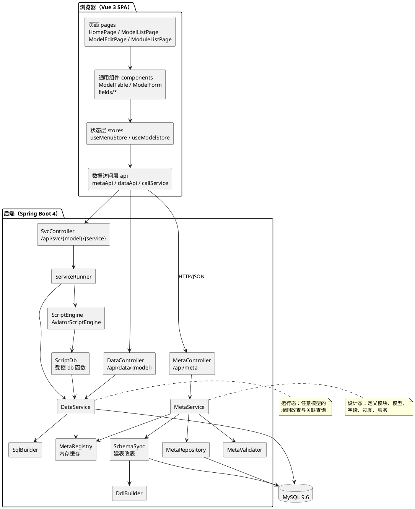
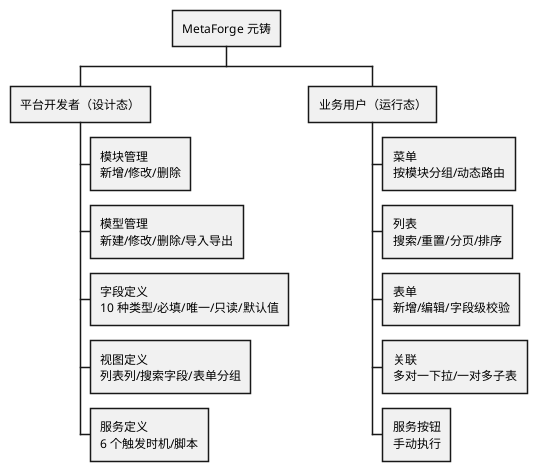
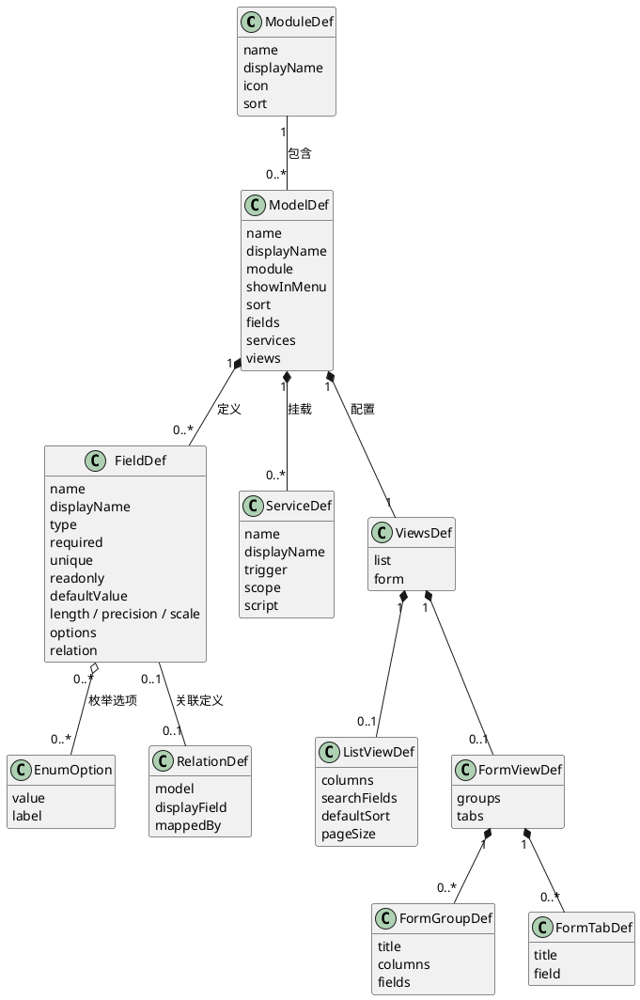
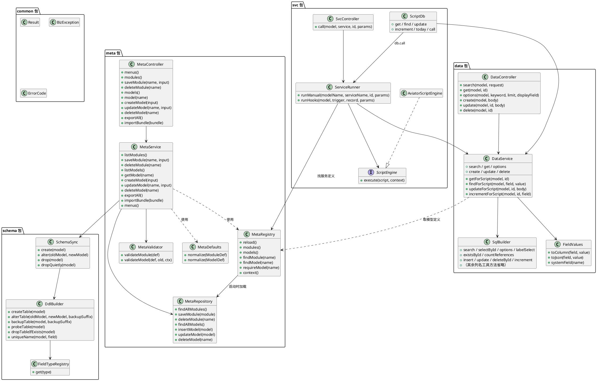
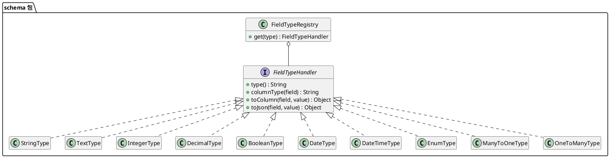
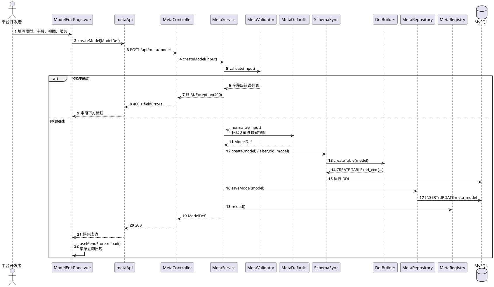
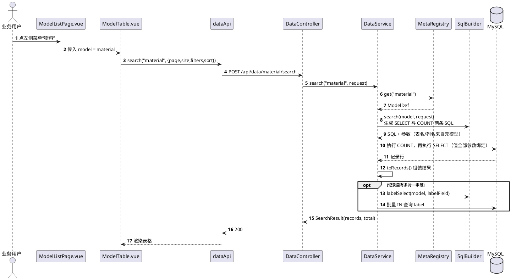
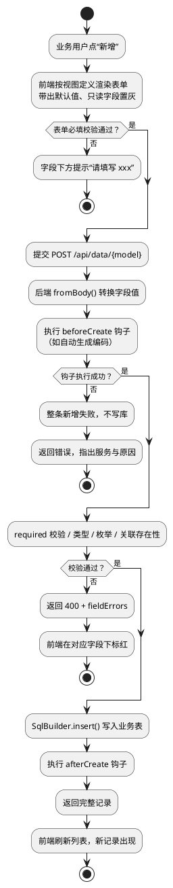

# 3 项目设计

> 本章的类名、方法名、接口路径均取自 `backend/src/main/java`、`frontend/src` 和 `docs/contract/`，与代码一致。图中虚线表示尚未实现或计划中的部分。
>
> 8 张图已导出为 PNG 和独立 `.puml`，放在 `docs/dev-doc/images/design/`（`01-architecture` 到 `08-activity-create`），转 Word 时直接引用 PNG。
>
> 素材文件 `docs/process/meetings/2026-11-19-设计图素材.md` 写于 main `516cecd`，当时 B5 服务引擎尚未实现。B5 已于 `8d4db9f` 合并，因此本章架构图、类图和时序图里的 `svc` 包（`ScriptEngine`、`AviatorScriptEngine`、`ScriptDb`、`ServiceRunner`、`SvcController`）按已实现代码绘制，使用实线。

## 1 概要设计

### 1.1 系统架构

系统分四层：浏览器里的 Vue 3 单页应用、Spring Boot 后端、MySQL 数据库，以及贯穿前后的两类使用场景——**设计态**（开发者定义元模型）和**运行态**（业务用户使用系统）。

**关键点**：`MetaRegistry` 是元模型的唯一内存来源，`MetaService` 改完元模型后同时刷新它；`DataService` 只依赖 `MetaRegistry` 和 `SqlBuilder`，所以新增一个模型不需要新代码。`ScriptEngine` 是接口，选型未定时可以在实现层替换。

### 1.2 功能结构

### 1.3 分析类图

分析类图描述元模型的构成：模块包含模型，模型包含字段、服务和视图，字段通过关系定义指向另一个模型。

### 1.4 数据库设计

**元模型表**（两张，结构固定）：

| 表 | 列 | 说明 |
|---|---|---|
| `meta_module` | `name`（PK）、`display_name`、`icon`、`sort` | 模块 |
| `meta_model` | `name`（PK）、`module_name`、`definition`（JSON）、`created_at`、`updated_at` | 每个模型一整份定义（决策 001） |

**业务表**：每个模型一张真实表，表名 `md_{模型名}`，字段名与模型字段一致，另加系统字段 `id`（自增主键）、`created_at`、`updated_at`。字段类型到列类型的映射由 `FieldTypeHandler` 的实现类决定：

| 字段类型 | 列类型 | 附加约束 |
|---|---|---|
| string / text | `VARCHAR(n)` / `TEXT` | 唯一字段建唯一索引 |
| integer | `INT` | — |
| decimal | `DECIMAL(p,s)` | — |
| boolean | `TINYINT(1)` | — |
| date / datetime | `DATE` / `DATETIME` | — |
| enum | `VARCHAR(n)` | 存枚举的 value |
| manyToOne | `BIGINT` | 存目标记录 id，**不建外键**（决策 009） |
| oneToMany | 不落列 | 通过子表的 mappedBy 字段反查 |

### 1.5 接口设计

元模型接口 `/api/meta/*`、数据接口 `/api/data/{model}/*`、服务接口 `/api/svc/{model}/{service}` 的完整定义见 [`docs/contract/api.md`](../contract/api.md)，本章不重复。

## 2 详细设计

### 2.1 后端核心类图

图中的包名省略了 `com.metaforge.` 前缀：`meta` = `com.metaforge.meta`，`schema` = `com.metaforge.schema`，`data` = `com.metaforge.data`，`svc` = `com.metaforge.svc`，`common` = `com.metaforge.common`。虚线表示“使用/实现”，实线表示“依赖/聚合”。

### 2.2 字段类型策略类图

字段类型的差异收敛在一个接口上：每种类型负责自己的列类型和值转换，新增类型只加一个实现类并在 `FieldTypeRegistry` 注册。

> 前端有一张对称的注册表 `fields/index.ts`（字段类型 → 组件），两边靠 `docs/contract/meta-model.md` 的类型名对齐。

### 2.3 时序图一：开发者保存一个模型

**为什么先执行 DDL 再保存定义**：DDL 不能回滚。先建表，建表失败时元模型还停留在旧版本；如果先存定义再建表，失败就会留下“定义里有、库里没有”的状态（决策 005）。

### 2.4 时序图二：业务用户查询一页数据

### 2.5 活动图：新建一条记录

> 钩子在必填校验之前执行，和 `DataService.create()` 的实际顺序一致：`fromBody()` → `beforeCreate()` → `requireRequired()` → `validateRelations()` → 写库 → `afterCreate()`。

## 3 设计说明

| 设计点 | 选择 | 理由 |
|---|---|---|
| 元模型存储 | 每个模型一份 JSON（`definition` 列） | 定义总是整体读写，拆表后读一个模型要多次关联（决策 001） |
| 业务数据存储 | 每个模型一张真实表 | 搜索、排序、分页、唯一约束直接用数据库能力（决策 002） |
| 通用接口 | 一个 `DataController`，模型名作路径变量 | 新增模型不需要新增控制器（决策 003） |
| SQL 安全 | 表名列名只取自校验过的元模型，值全部参数绑定 | 元模型是唯一可信来源，请求里的字符串不进 SQL（决策 004） |
| 删字段/删模型 | 改名成 `zz_` 前缀留备份 | DDL 不可回滚，改名是毫秒级且数据可恢复（决策 005） |
| 脚本引擎 | AviatorScript 5.4.4 + 受控 `db` 函数 | 依赖 0.6 MB、冷启动约 11 ms、执行 1000 次约 38 ms；内置沙箱与超时，Groovy 体积和冷启动都大一个量级（决策 006） |
| 关联关系 | 多对一返回 `{id,label}`、不级联保存、不建外键 | 列表无需二次查询；外键会挡住“改名留备份”的改表方式（决策 009） |
