::: {custom-style="Title"}
MetaForge 元铸
:::

::: {custom-style="Subtitle"}
模型驱动的低代码平台
:::

::: {custom-style="Body Text"}
**项目开发文档**

课程：《中级软件设计实作》

课题：课题 4 实现模型驱动开发的低代码平台

小组成员：李奕铭、丘靖伟、马韶廷

日期：2026-11-25
:::

```{=openxml}
<w:p><w:r><w:br w:type="page"/></w:r></w:p>
```

::: {custom-style="TOC Heading"}
目录
:::

```{=openxml}
<w:p><w:r><w:fldChar w:fldCharType="begin"/></w:r><w:r><w:instrText xml:space="preserve">TOC \o "1-3" \h \z \u</w:instrText></w:r><w:r><w:fldChar w:fldCharType="separate"/></w:r><w:r><w:t>在 Word 中右键选择“更新域”生成目录</w:t></w:r><w:r><w:fldChar w:fldCharType="end"/></w:r></w:p>
```


```{=openxml}
<w:p><w:r><w:br w:type="page"/></w:r></w:p>
```

# 1 需求分析

> 组内成员：李奕铭（后端）、丘靖伟（前端）、马韶廷（文档）。

## 1.1 调查对象和方式

需求来自三处：课题原文的四条要求、小组内部的方案讨论、对两类用户的问卷访谈。

问卷分两份，每份 5 题，2026-11-14 至 11-15 在小组群内发放，要求按实际经历作答、每题一两句话：

- **问卷 A 平台开发者**：发给组内两位成员。两人都在课上用 IIDP（工业数字平台）以注解方式开发过 MES 案例，既有“作为开发者定义模型”的经验，也踩过编译、重启的坑。这份问卷回答的是“做平台的人需要什么”。
- **问卷 B 业务用户**：由负责文档的同学按课上使用 MES 案例的体验作答。这份问卷回答的是“用平台做出来的系统，使用者需要什么”。

调查方式为文字问卷加当场追问，回答原文照录在第 1.2 节，未做改写。与问卷同时收集了各人对所用技术的熟悉程度和预计工时，用于第 2 章的可行性分析。

## 1.2 需求调查表

| 题号 | 问题 | 回答人 | 回答原文 | 由此得到的需求编号 |
|---|---|---|---|---|
| A-1 | 让你在平台上加一个新业务对象（比如“供应商”），你希望从哪一步开始填？希望平台自动帮你做完哪些事？ | 丘靖伟（前端） | 希望只填「标识 + 显示名」这两样最少的，剩下的全自动：建表、增删改查接口、菜单、列表页、表单页都自动生成。我刷新一下页面，「供应商」就出现在菜单里、能直接用了，不用碰任何代码。 | FR-01、FR-02、FR-07、FR-27 |
| A-1 | 同上 | 李奕铭（后端） | 先选一个模块，填模型名和显示名，然后一个个加字段：标识、显示名、类型、要不要必填/唯一/默认值。保存之后希望平台自动把剩下的都做完——建好数据库表、给一份能直接用的列表页和表单页（不用我自己配视图）、菜单里自动出现、接口立刻就能调，不写一行代码也不重启。 | FR-01、FR-02、FR-05、FR-07、FR-27 |
| A-2 | 给“物料”加一个字段，你希望多久能用上？能接受重启系统或者重新编译吗？ | 丘靖伟（前端） | 希望保存后立刻生效，刷新页面就能用，几秒钟内。不能接受重启系统或重新编译——加个字段还要重启，那跟写代码没区别了，就失去低代码的意义了。 | FR-08、FR-26 |
| A-2 | 同上 | 李奕铭（后端） | 保存完刷新一下就要能用，不能接受重启，更不能重新编译。IIDP 就是注解写的，加个字段要改代码、编译、重启，一次好几分钟，调试的时候特别难受——这也是我们把模型定义改存成数据、运行时生效的直接原因。 | FR-08、FR-26 |
| A-3 | 定义字段的时候你希望有哪几种类型？哪些校验希望平台自动做？说一个你在 IIDP 上踩过的坑。 | 丘靖伟（前端） | 单行文本、多行文本、整数、小数、布尔、日期、日期时间、枚举、关联（多对一/一对多），这些就够。必填、唯一、默认值希望平台自动校验，不用我手写。IIDP 的坑：改一个字段类型要回注解改、重新编译，编译报错还得来回找，忘了同步数据库页面和数据就对不上，很折腾。 | FR-03、FR-04、FR-17、FR-18、FR-19 |
| A-3 | 同上 | 李奕铭（后端） | 类型：单行文本、多行文本、整数、小数、是否、日期、日期时间、单选枚举、多对一关联（一对多当子表用）。校验希望自动做：必填、唯一（有重复时告诉我哪条重复）、默认值、枚举只能选定义里的选项、关联必须指向存在的记录、标识名只允许字母数字下划线。坑：在 IIDP 上加完字段忘了重新编译，页面上就是没有，排查半天以为是代码写错了。 | FR-03、FR-04、FR-17、FR-18、FR-19 |
| A-4 | 你要写一个“新增前自动生成编码”的服务，希望在哪里写、怎么确认它生效了？出错的时候希望看到什么提示？ | 丘靖伟（前端） | 希望在模型设计器里选「新增前」这个触发时机、直接写脚本，不用改代码重启。保存后去点「新增」填一条，看到编码自动出来就说明生效了。出错时希望页面给明确的中文提示（是哪条脚本、什么原因），而不是只给个 500。 | FR-06、FR-24、FR-25、FR-29 |
| A-4 | 同上 | 李奕铭（后端） | 写在设计器的「服务」里，触发时机选 beforeCreate，脚本里能读当前要保存的记录、调编码规则里的计数器、把 code 填上；写的时候最好有「试运行」，拿一份样例数据先跑一遍看返回值，再真新增一条记录看编码对不对，就说明生效了。出错时希望提示具体到「哪条服务、哪一步、什么错」（比如引用了一个空值），并且这次新增整体失败、别写进去半条；如果是我自己写的业务校验没过，希望错误挂在对应字段下面，而不是一句「服务器错误」。 | FR-06、FR-24、FR-25、FR-29 |
| A-5 | 模型已经用了几天，你发现某个字段类型选错了，你希望平台怎么处理已有的数据？哪些操作你希望它干脆禁止？ | 丘靖伟（前端） | 希望至少不丢数据：能自动转换就自动转，转不了的给明确警告。最好直接禁止改字段类型（改成「新增字段」代替），删模型/字段这种会丢数据的操作也要二次确认、并检查有没有被别处引用。 | FR-08、FR-09、FR-21 |
| A-5 | 同上 | 李奕铭（后端） | 先拿现有数据试一遍能不能转，转不了就把有问题的记录列出来让我决定，别悄悄把值变成 0 或 null；确认后再在事务里转。希望禁止的：把长度缩到装不下现有值、现有值有重复还加唯一约束、改字段名（应该当「删一个加一个」处理）、物理删列（我们的做法是改名留备份）、改关联指向的模型。 | FR-08、FR-09、FR-21 |
| B-1 | 你录入一条物料时，哪些信息希望系统自动填好？为什么？ | 马韶廷（文档） | 物料编码希望系统按编码规则自动生成，不用我记；类别、单位、安全库存、启用这几个希望带默认值（原材料、个、0、是），我只改需要改的。手工填编码最容易填重，也记不住编号规则。 | FR-16、FR-19、FR-25 |
| B-2 | 系统里有 200 条物料，你要找“螺丝 M3”的一条，你希望怎么找？找完以后想恢复看全部，怎么操作最顺手？ | 马韶廷（文档） | 希望列表上方有个搜索框，按名称输入片段就模糊匹配，结果留在当前页不要跳走。找完想恢复全部数据，希望有个“重置”按钮一键清空条件，而不是逐条删搜索词。条目多的时候还希望能翻页、按列排序。 | FR-14、FR-15 |
| B-3 | 填错了（必填没填、编码和别人的重复），你希望什么时候、在哪个位置被提醒？说一个你被系统坑过的例子。 | 马韶廷（文档） | 希望保存时直接提示在出问题的字段下面，比如“编码已存在”“名称不能为空”，不要只在页面角落弹一句“保存失败”，我还得自己猜是哪个字段。课上用 MES 录物料时，编码填重了只提示保存失败，我把整页看了一遍才发现是编码撞了。 | FR-17、FR-18、FR-29 |
| B-4 | 一个产品的物料清单（BOM），你希望在哪里维护？新建一个产品的时候，你希望先保存产品再加明细，还是边填产品边加明细？ | 马韶廷（文档） | 希望在产品表单下方的“BOM 明细”标签页里维护，看着产品信息加明细，不用跳到另一个页面。新建产品的时候，希望先保存产品本身再加明细，否则明细不知道该挂到哪个产品上。 | FR-23 |
| B-5 | 你要把一条物料关联到一个供应商，希望怎么选？关联完在列表里，你希望看到供应商的名字还是编号？ | 马韶廷（文档） | 希望用能搜索的下拉框，输“华”就能筛出“华强电子”这种，不用记全名。列表里希望显示供应商的名称，不要只显示一串编号，看不出是谁。 | FR-13、FR-22 |

: 表 1-1 需求调查表


### 1.2.1 未纳入本次版本的需求

调查中有两条需求本期不做，记录在此，作为后续版本的方向：

| 需求 | 来源 | 不做的原因 |
|---|---|---|
| 服务的“试运行”：用一份样例数据先跑脚本、看返回值 | A-4（李奕铭） | 需要额外的脚本沙箱和参数录入界面，工期不够；先用“真新增一条记录看结果”替代 |
| 脚本中可以写自定义业务校验、错误挂到字段下 | A-4（李奕铭） | 依赖脚本引擎能否抛结构化错误，属 FR-29 的扩展；本期只保证系统内置校验的字段级提示 |
| 改字段类型时自动列出无法转换的记录、确认后事务转换 | A-5（李奕铭） | 本期直接禁止修改已有字段类型（FR-08），从根上避免数据转换问题 |

: 表 1-2 未纳入本次版本的需求


## 1.3 用户角色

| 角色 | 是谁 | 要完成的事 |
|---|---|---|
| 平台开发者 | 有开发背景、用设计器定义业务对象的人。本项目中由组内成员承担。 | 建模块、建模型、定义字段和视图、写服务；改完立刻验证效果；导出元模型交付 |
| 业务用户 | 使用搭建出来的系统的人，例如 MES 里的仓管、生产计划员。不懂技术，也不关心模型怎么定义。 | 按菜单找到模型、查询记录、新增/编辑/删除记录、维护子表明细、点服务按钮 |

: 表 1-3 用户角色


两类角色的分界不是权限系统，而是**使用阶段**：开发者处在“设计态”，业务用户处在“运行态”。同一个模型，定义时由开发者操作，运行时由业务用户使用。

## 1.4 用例

### 1.4.1 用例图

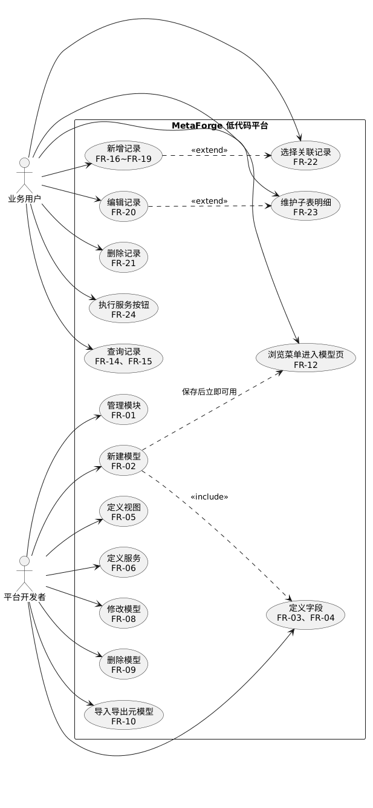


### 1.4.2 用例一览表

| 用例 | 角色 | 一句话说明 | 功能编号 |
|---|---|---|---|
| UC01 管理模块 | 平台开发者 | 新增、修改、删除模块；模块下还有模型时不能删 | FR-01 |
| UC02 新建模型 | 平台开发者 | 填标识、显示名、所属模块，保存后自动建表、出菜单、出接口 | FR-02、FR-07 |
| UC03 定义字段 | 平台开发者 | 为模型加字段，选类型、设置必填/唯一/只读/默认值，枚举要配选项 | FR-03、FR-04 |
| UC04 定义视图 | 平台开发者 | 配列表列、搜索字段、默认排序、表单分组；不配则自动生成 | FR-05 |
| UC05 定义服务 | 平台开发者 | 给模型加脚本服务，选择触发时机 | FR-06 |
| UC06 修改模型 | 平台开发者 | 加字段立即可用、旧数据不丢；已有字段类型不能改 | FR-08 |
| UC07 删除模型 | 平台开发者 | 被别的模型关联引用时不允许删除 | FR-09 |
| UC08 导入导出元模型 | 平台开发者 | 全部元模型导出成 JSON，导入后恢复 | FR-10 |
| UC09 浏览菜单进入模型页 | 业务用户 | 按模块分组看到模型，点进去是本模型的列表页，刷新不丢 | FR-12 |
| UC10 查询记录 | 业务用户 | 按字段搜索、重置、分页、点列头排序 | FR-14、FR-15 |
| UC11 新增记录 | 业务用户 | 表单按视图分组、带默认值，必填和唯一校验，只读字段不可填 | FR-16~FR-19、FR-25 |
| UC12 编辑记录 | 业务用户 | 带出原值，保存后列表更新 | FR-20 |
| UC13 删除记录 | 业务用户 | 二次确认；被引用时不能删并说明被谁引用 | FR-21 |
| UC14 选择关联记录 | 业务用户 | 多对一字段用可搜索下拉框选 | FR-22 |
| UC15 维护子表明细 | 业务用户 | 主记录表单下用标签页增删改子记录；主记录要先保存 | FR-23 |
| UC16 执行服务按钮 | 业务用户 | 点按钮调用手动服务，显示返回结果 | FR-24 |

: 表 1-4 用例一览表


### 1.4.3 三个核心用例的详细描述

#### 1.4.3.1 UC02 定义一个模型

- **角色**：平台开发者
- **前置条件**：已登录；至少已有一个模块（否则先执行 UC01）
- **基本流程**：
  1. 开发者打开模型设计器，点“新建模型”；
  2. 填写标识、显示名，选择所属模块；
  3. 逐条添加字段：标识、显示名、类型；需要时勾选必填、唯一、只读，填写默认值；枚举类型填写选项；
  4. 点“保存”；
  5. 系统校验全部定义：标识格式、字段是否重名、枚举是否有选项、关联目标是否存在、视图是否引用了不存在的字段；
  6. 系统写入元模型，按字段定义建立或调整数据库表；
  7. 系统刷新菜单与路由，该模型的增删改查接口立即可用；
  8. 开发者从左侧菜单进入该模型，新增一条记录，确认定义正确。
- **异常流程**：
  - 3a 标识不符合规则（须以小写字母开头，只含小写字母、数字、下划线，最长 30 位）：在字段下方当场提示，不能保存；
  - 3b 枚举字段没有任何选项：提示“枚举字段至少要有一个选项”，不能保存；
  - 4a 校验不通过（字段重名、关联指向不存在的模型、视图引用不存在的字段）：返回错误并指出具体字段，元模型不写入；
  - 4b 同名模型已存在：提示冲突，保留原有模型；
  - 6a 建表失败：本次保存整体不生效，元模型和数据库都保持原状。
- **后置条件**：新模型出现在菜单中，拥有自动生成的列表页、表单页和接口。

#### 1.4.3.2 UC11 新增一条记录

- **角色**：业务用户
- **前置条件**：模型已定义并出现在菜单中；记录的唯一字段没有冲突
- **基本流程**：
  1. 用户点击左侧菜单进入模型列表页；
  2. 点“新增”；
  3. 系统按视图定义的字段分组显示表单，带出各字段的默认值，只读字段置灰；
  4. 用户填写必填字段；
  5. 点“保存”；
  6. 后端校验：必填、类型、枚举选项、唯一性、关联记录是否存在；
  7. 如果模型有“新建前”服务，先执行服务（例如生成编码），把结果写回记录；
  8. 写入数据库，返回完整记录；
  9. 列表刷新，新记录出现在列表中。
- **异常流程**：
  - 4a 必填字段为空就点保存：在该字段下方提示必填，不提交；
  - 6a 值的类型不对、枚举值不在选项内、关联记录不存在：返回错误，指出对应字段；
  - 6b 唯一字段与已有记录重复：提示“已存在”，并说明与哪条记录冲突；
  - 7a 服务执行出错：整条新增失败，不写入半条记录，错误信息指出是哪条服务、什么原因。
- **后置条件**：记录落库；列表和分页总数同步更新。

#### 1.4.3.3 UC15 维护子表明细

- **角色**：业务用户
- **前置条件**：主模型有一个“一对多”字段（例如产品的 BOM 明细）；主记录已经保存
- **基本流程**：
  1. 用户打开主记录的编辑页；
  2. 切换到子表标签页（例如“BOM 明细”）；
  3. 点“新增”添加一行；
  4. 在行内选择关联记录（可搜索下拉框）、填写数量等字段；
  5. 点“保存”；
  6. 系统校验子记录并写入，子记录自动挂到当前主记录下；
  7. 标签页列表刷新，显示新增的明细行。
- **异常流程**：
  - 1a 主记录尚未保存（处于新增状态）：子表的新增按钮不可用，或提示“请先保存主记录”；
  - 4a 必填的关联字段没有选择：提示必填；
  - 4b 关联的记录已被别人删除：提示记录不存在，需重新选择；
  - 5a 子记录校验失败：指出具体字段，已填内容保留以便修改。
- **后置条件**：子记录与主记录关联；主记录的关联数量随之变化。

## 1.5 功能需求表

| 编号 | 需求描述 | 来源 | 优先级 | 验收方式 |
|---|---|---|---|---|
| FR-01 | 模块管理：新增、修改、删除模块，模块有标识、显示名、图标、排序；模块下还有模型时不能删除 | 课题第 2 条；A-1 | 必须 | TC-01、TC-02 |
| FR-02 | 新建模型：填写标识、显示名、所属模块；标识须小写字母开头，只含小写字母、数字、下划线，最长 30 位，不合规当场提示 | 课题第 2 条；A-1、A-3 | 必须 | TC-03、TC-04 |
| FR-03 | 定义字段：支持 10 种类型（单行文本、多行文本、整数、小数、是否、日期、日期时间、枚举、多对一、一对多）；可设置必填、唯一、只读、默认值 | 课题第 2 条；A-3 | 必须 | TC-05、TC-06 |
| FR-04 | 枚举字段至少要有一个选项，否则不能保存 | A-3（李奕铭） | 必须 | TC-07 |
| FR-05 | 定义视图：列表显示哪些列及顺序、搜索字段、默认排序、表单分组；不定义时自动生成默认视图 | 课题第 2 条；A-1 | 应该 | TC-08、TC-09 |
| FR-06 | 定义服务：给模型添加脚本服务，触发时机可选手动调用、新建前、新建后、修改前、修改后、删除前 | 课题第 2 条；A-4 | 必须 | TC-10 |
| FR-07 | 保存模型后不重启、不刷新页面，左侧菜单立即出现该模型 | 课题第 3 条；A-1 | 必须 | TC-11 |
| FR-08 | 修改模型：新增字段立即可用、已有数据不丢失；已保存字段的类型不能修改 | 课题第 3 条；A-2、A-5 | 必须 | TC-12、TC-13 |
| FR-09 | 删除模型：被其它模型的关联字段引用时不能删除，并提示被谁引用 | A-5 | 应该 | TC-14 |
| FR-10 | 导出和导入：全部元模型导出成 JSON；导入 JSON 恢复元模型，整包要么全部成功要么全部不生效 | 小组自定（交付与备份需要） | 应该 | TC-15、TC-16 |
| FR-11 | AI 助手：输入一句话描述生成模型定义预览，用户确认后才生效 | 课题加分项 | 加分 | 加分项、不排主线，有余力再做 |
| FR-12 | 菜单：按模块分组显示模型，点击进入列表页；每个模型有独立地址，刷新后仍停留在该页 | 课题第 3 条；A-1 | 必须 | TC-17 |
| FR-13 | 列表页按视图定义显示列；枚举显示中文选项，是否显示“是/否”，关联字段显示对方名称 | A-3；B-5 | 必须 | TC-18 |
| FR-14 | 搜索：文本模糊匹配，枚举精确匹配；重置后恢复全部数据 | B-2 | 必须 | TC-19、TC-20 |
| FR-15 | 分页；点击列头排序 | B-2 | 应该 | TC-21、TC-22 |
| FR-16 | 新增记录：表单按视图分组排列，带出字段默认值 | 课题第 4 条；B-1 | 必须 | TC-23 |
| FR-17 | 必填校验：必填字段没填时在该字段下方提示，不能保存 | A-3；B-3 | 必须 | TC-24 |
| FR-18 | 唯一校验：唯一字段的值与已有记录重复时，在该字段下方提示“已存在” | A-3；B-3 | 必须 | TC-25 |
| FR-19 | 只读字段不能填写，例如由系统自动生成的编码 | A-4；B-1 | 必须 | TC-26 |
| FR-20 | 编辑记录：带出原值，保存后列表更新 | 课题第 4 条 | 必须 | TC-27 |
| FR-21 | 删除记录：需要确认；记录被其它记录引用时不能删除并说明被谁引用 | A-5；课题第 4 条 | 必须 | TC-28、TC-29 |
| FR-22 | 多对一字段用可搜索的下拉框选择关联记录 | A-3；B-5 | 必须 | TC-30 |
| FR-23 | 一对多：在主记录表单下方用标签页显示子表，可增删改子记录；新建的主记录要先保存才能添加子记录 | A-3；B-4 | 必须 | TC-31、TC-32 |
| FR-24 | 手动服务显示成按钮，点击后执行并显示结果，例如编码规则的“生成编码” | A-4 | 必须 | TC-33 |
| FR-25 | 自动服务：新增物料时不填编码，保存后按编码规则自动生成编码 | A-4；B-1 | 必须 | TC-34 |
| FR-26 | 元模型的任何修改都不需要重启后端 | 课题第 3 条；A-2 | 必须 | TC-35 |
| FR-27 | 任意模型自动拥有增删改查接口，不需要为它单独写代码 | 课题第 3 条 | 必须 | TC-36 |
| FR-28 | 接口收到非法的字段名或排序方式时返回错误，不会被用来执行恶意的数据库语句 | 小组自定（技术风险评估，见可行性分析 1.2） | 必须 | TC-37 |
| FR-29 | 出错时错误信息能定位到具体的字段 | A-4 | 应该 | TC-38 |

: 表 1-5 功能需求表


## 1.6 非功能需求

| 编号 | 需求 | 怎么判断达到了 |
|---|---|---|
| NFR-01 | 元模型的修改不重启即生效 | 新建或修改模型后，不重启后端、不刷新页面，菜单里立即出现、立刻能增删改查（TC-35） |
| NFR-02 | 数据库语句安全 | 表名和列名只能取自校验过的元模型，值一律参数绑定；用非法字段名、非法排序方式请求接口，返回 400 而不是执行（TC-37）；代码审查时逐条检查拼接点 |
| NFR-03 | AI 生成的内容必须经人确认 | AI 助手只返回预览，不落库；必须用户确认后调用导入接口才生效（FR-11 是加分项、不排主线；若实现必须遵守此约束） |
| NFR-04 | 界面不看文档也能用 | 由没写过平台代码的成员独立完成“建模型 → 加字段 → 新增记录”，过程中不查阅开发文档，只靠界面提示（D5 的执行过程即为验证） |
| NFR-05 | 已有的业务数据不能因为改模型而丢失 | 给已有数据的模型加字段后，原有记录仍在、新字段为空（TC-12）；禁止修改已保存字段的类型（TC-13） |

: 表 1-6 非功能需求


## 1.7 小结

课题原文的四条要求与功能编号的对应关系：

| 课题原文要求 | 对应的功能编号 | 说明 |
|---|---|---|
| 1. 使用熟悉的技术开发一个模型驱动开发的低代码平台 | 技术选型见可行性分析第 1 章；平台整体由 FR-01 至 FR-29 共同实现 | 用三人已接触过的 Java、Vue 技术栈，不引入新语言 |
| 2. 开发者可以通过定义模型、属性、服务、视图 | FR-01、FR-02、FR-03、FR-04、FR-05、FR-06 | 设计态的四类定义对象 |
| 3. 平台动态加载元模型、动态生成 api、动态渲染视图、前端动态生成路由 | FR-07、FR-08、FR-12、FR-13、FR-26、FR-27 | 元模型存成数据、运行时读取，是四条里技术含量最高的一条 |
| 4. 需要在这个平台上面做一个简单的管理系统 | FR-14 至 FR-25 | 用 MES 示例（物料、产品、BOM、编码规则）证明平台可用 |

: 表 1-7 小结


# 2 项目可行性分析

## 2.1 技术可行性

### 2.1.1 技术选型

| 技术 | 用途 | 选它的理由（针对本项目） | 团队熟悉程度 |
|---|---|---|---|
| Java 21 + Spring Boot 4.0.5 | 后端框架，提供 REST 接口 | 三人中后端对 Spring Boot 最熟，写过普通的增删改查；Spring Boot 内嵌容器、启动只要几秒，改完立刻能验证“不重启生效”这类需求 | 李奕铭：用过，写过普通增删改查；运行时建表、动态路由是第一次 |
| NamedParameterJdbcTemplate | 访问数据库 | 业务模型是运行时才定义的，没有对应的 Java 实体类，ORM 的映射层用不上；而表名、列名必须动态拼接，字段值必须参数绑定，JdbcTemplate 正好同时满足这两点 | 李奕铭：学过但没写过 |
| MySQL 8 | 数据库 | 课程上学过、本机已有；支持 DDL、事务和唯一索引，能满足运行时建表和唯一校验；utf8mb4 存中文不出问题 | 李奕铭：学过但没写过；动态 DDL、唯一索引、事务是第一次真正写 |
| Vue 3 | 前端框架 | 前端同学上课用过；组合式 API 便于把通用列表页、表单页各封装成一个组件，供所有模型复用 | 丘靖伟：上课用过 |
| TypeScript | 前端语言 | 前后端只通过 `docs/contract` 对接，TS 能把契约里的类型落到代码里，字段名写错在编译期就能发现，减少联调时的返工 | 丘靖伟：学过，但没系统写过 |
| Vue Router | 动态路由 | 平台的路由不是写死的，要按菜单在运行时注册，只能用它的运行时 API（addRoute） | 丘靖伟：学过，这次真正用上 |
| Ant Design Vue 4 | 界面组件库 | 低代码平台的前端大量是表格、表单、弹窗、下拉框，组件库直接提供，省掉自己写样式的时间 | 丘靖伟：第一次接触 |
| Pinia | 全局状态 | 菜单树和当前模型的元模型要被多个页面共用，避免一层层传参 | 丘靖伟：第一次接触 |
| Vite | 前端构建 | 开发时热更新快，改一行立刻看到效果；联调阶段反复改界面时节省时间 | 丘靖伟：第一次接触 |
| Git + GitHub | 版本管理 | 三人并行开发，用分支加 PR 评审，避免互相覆盖；提交记录本身也是过程文档的材料 | 三人都在用 |

: 表 2-1 技术选型


### 2.1.2 技术难点与对策

| 技术难点 | 难在哪里 | 计划的对策 |
|---|---|---|
| 运行时建表、改表 | MySQL 的 DDL 执行后不能回滚，一条修改语句失败时，前面的语句已经生效，可能留下半新半旧的结构 | 保存模型时先把整个定义校验一遍（标识格式、字段重名、枚举选项、关联目标、视图字段），全部通过才执行；建表、改表的 DDL 先执行，成功后才保存新定义，失败时定义仍是旧的；删字段、删模型不物理删除，把列或表改名成 `zz_` 前缀留备份 |
| 表名和列名要拼进数据库语句 | 表名和列名不能用参数绑定的方式传，只能拼字符串，一旦来自用户输入就是注入入口 | 表名和列名只取自校验过的元模型，并限定为“小写字母开头、只含小写字母数字下划线”；所有值一律参数绑定；比较方式和排序方向也只认白名单，接口收到不存在的字段名或非法排序方式直接返回 400 |
| 脚本服务与并发生成编码 | 脚本要在 JVM 里执行用户写的内容；多人同时点“生成编码”时，先读再加的写法会撞号 | 在 Groovy 和 AviatorScript 之间比较后选定引擎（决策 006 尚未定，B5 开工时做对比）；流水号自增在数据库里一步完成，执行 `UPDATE ... SET current_serial = current_serial + 1` 后读回新值，不做“先查询再写回” |
| 前端动态路由刷新丢失 | 路由是登录后按菜单注册的，刷新页面时路由还没注册，地址匹配先发生，直接 404 | 在全局路由守卫里先加载菜单、注册路由，再重新匹配当前地址；菜单里没有的模型自然没有路由，非法地址也就进不去 |
| 三人并行，接口容易对不上 | 前后端同时开工，各自理解的字段名、分页参数、错误格式容易不一致 | 开工前先写 `docs/contract`（元模型定义、接口、示例 JSON）；前端先对着按契约实现的假数据开发；每个任务一个分支，通过 PR 评审后再合并 |
| 工期只有两周多 | 四条课题要求之外还有两份文档、PPT、视频，加分项做不完 | 四条课题要求优先；AI 助手列为加分项、不排主线，有余力再做；服务“试运行”本期不做；设计图等系统稳定后再画 |

: 表 2-2 技术难点与对策


### 2.1.3 结论

技术上可行。三人对主技术栈都不是第一次接触，真正的风险集中在“运行时 DDL”和“动态路由”两处，都有明确对策；其中运行时建表、动态路由、通用列表页已在 B1、B2、F1 至 F3 中实现并验证过。

## 2.2 经济可行性

### 2.2.1 成本表

**人力成本**

| 成员 | 负责部分 | 估算依据 | 估算工时 | 实际工时（截至 11/16，各人自估） |
|---|---|---|---|---|
| 李奕铭 | 后端 B1–B8 | 纯写代码按任务估算约 17 小时；另加代码评审、联调、返工、给文档提供素材 | 40–50 小时 | 约 32–38 小时：B1、B2 实际约 12–14 小时（主要耗在真实 MySQL 上调试），B3–B8 约 20–24 小时 |
| 丘靖伟 | 前端 F1–F7 | F1–F7 加 2 次联调 | 约 40 小时 | 约 40 小时：F1–F3 约 18 小时，F4–F7 与两次联调约 22 小时 |
| 马韶廷 | 文档、测试、PPT、视频 | 按任务包估算：D1 全程记录约 8 小时、D2/D3 各 6 小时、D4 用例 5 小时、D5 建模 2 小时、D6 设计图 8 小时、D7 成稿 8 小时、D8 PPT 4 小时、D9 视频 3 小时 | 约 44 小时 | 截至 11/16 约 23 小时：D1 记录 8 小时、D2/D3 10 小时、D4 用例 5 小时 |

: 表 2-3 成本表


> 实际工时一列截至 2026-11-16，由各人自估；后续任务完成后继续累加。

**软件成本**

| 软件 | 用途 | 许可 | 费用 |
|---|---|---|---|
| Java 21（OpenJDK） | 运行后端 | GPL-2.0 + Classpath Exception | 0 |
| Spring Boot 4.0.5 | 后端框架 | Apache-2.0 | 0 |
| MySQL 社区版 | 数据库 | GPL-2.0 | 0 |
| Vue 3、Vue Router、Pinia、Vite | 前端框架与构建 | MIT | 0 |
| TypeScript | 前端语言 | Apache-2.0 | 0 |
| Ant Design Vue | 界面组件库 | MIT | 0 |
| Git、GitHub | 版本管理与协作 | GPL-2.0；公共仓库免费 | 0 |

: 表 2-4 成本表


**AI 工具成本**

| 成员 | 使用的工具 | 用途 | 费用 |
|---|---|---|---|
| 李奕铭 | Claude Code、DeepSeek harness | Claude Code 负责搭框架，DeepSeek harness 负责代码实现 | Claude Code 付费，约 6 元 |
| 丘靖伟 | DeepSeek coding agent | 按需求写代码初稿、跑构建 | 10 元 |
| 马韶廷 | Claude Code | 文档撰写、用例编写 | 付费，约 5 元 |

: 表 2-5 成本表


**硬件成本**

三人各自使用已有的个人电脑，不新增设备，费用为 0。

### 2.2.2 收益

- **学习价值**：这个项目逼着我们处理三个课本上讲得少的问题——运行时改变了数据库结构、把用户写的内容拼进 SQL、路由在运行时才存在。这三个问题在普通 CRUD 项目里遇不到。
- **对照价值**：课上用 IIDP 时，模型信息写在 Java 注解里，改一次要重新编译；自己实现一遍后，能说清楚“注解”和“存成数据”两种做法的代价分别是什么，这是答辩时最有话可讲的部分。
- **工程价值**：三个人并行、靠契约对接、用 PR 评审，完整走了一遍小团队的协作流程；文档、测试、视频也都要落到具体内容上。

### 2.2.3 结论

经济上可行。除个人电脑外没有新增支出，软件全部免费；AI 工具合计约 21 元（6 + 10 + 5）。

## 2.3 时间可行性

| 时间 | 安排 |
|---|---|
| 11/13 | 搭好项目骨架，定好前后端接口契约 |
| 11/14–11/15 | 集中开发，每晚一次联调 |
| 11/16–11/20 | 修问题，用设计器配 MES 示例，画设计图 |
| 11/21–11/22 | 两份文档成稿，做 PPT |
| 11/23–11/26 | 录演示视频 |
| 11/27–11/28 | 提交前总检查 |
| 11/29 | 提交 |

: 表 2-6 时间可行性


时间偏紧但没有超出可控范围。如果进度落后，按下面的顺序让路：

1. **先放弃**：服务“试运行”、改字段类型时的自动数据转换；AI 助手（FR-11）是加分项、不排主线，有余力再做。
2. **再压缩**：设计图的张数（保两张时序图、一张活动图），演示视频的剪辑精细度。
3. **必须保住**：课题的四条要求、测试用例与执行记录、项目开发文档和过程文档、演示视频。

## 2.4 总结

技术上，主技术栈三人都有基础，风险点有明确对策且部分已验证；经济上几乎没有成本；时间上两周多偏紧，但已经划定了“先放弃什么、必须保住什么”。综合判断，项目可行。


# 3 项目设计

> 本章的类名、方法名、接口路径均取自 `backend/src/main/java`、`frontend/src` 和 `docs/contract/`，与代码一致。图中虚线表示尚未实现或计划中的部分。
>
> 8 张图已导出为 PNG 和独立 `.puml`，放在 `docs/dev-doc/images/design/`（`01-architecture` 到 `08-activity-create`），转 Word 时直接引用 PNG。
>
> 素材文件 `docs/process/meetings/2026-11-19-设计图素材.md` 写于 main `516cecd`，当时 B5 服务引擎尚未实现。B5 已于 `8d4db9f` 合并，因此本章架构图、类图和时序图里的 `svc` 包（`ScriptEngine`、`AviatorScriptEngine`、`ScriptDb`、`ServiceRunner`、`SvcController`）按已实现代码绘制，使用实线。

## 3.1 概要设计

### 3.1.1 系统架构

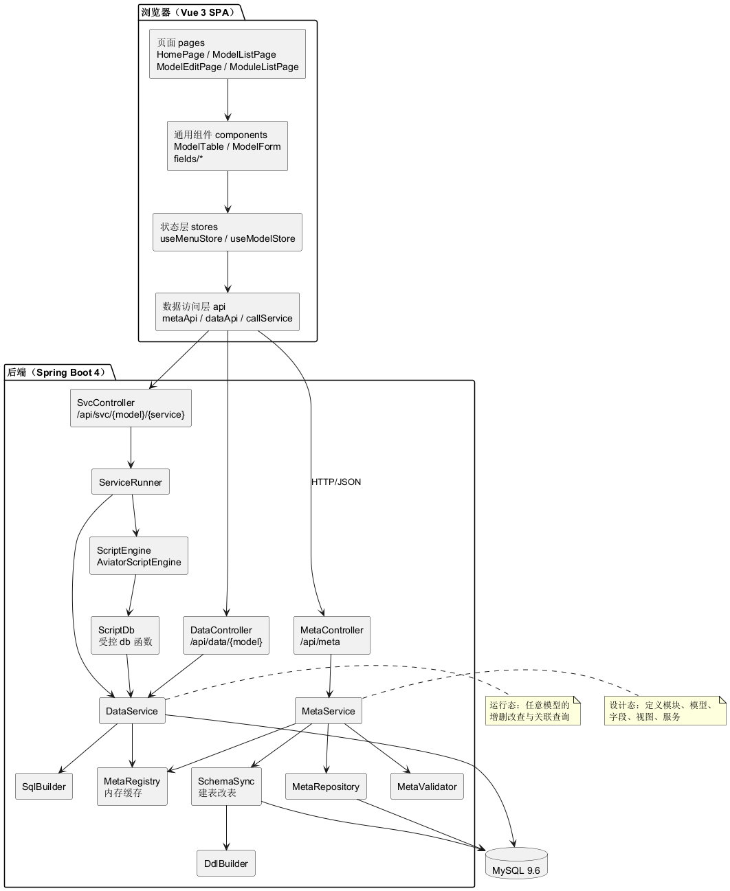

系统分四层：浏览器里的 Vue 3 单页应用、Spring Boot 后端、MySQL 数据库，以及贯穿前后的两类使用场景——**设计态**（开发者定义元模型）和**运行态**（业务用户使用系统）。


**关键点**：`MetaRegistry` 是元模型的唯一内存来源，`MetaService` 改完元模型后同时刷新它；`DataService` 只依赖 `MetaRegistry` 和 `SqlBuilder`，所以新增一个模型不需要新代码。`ScriptEngine` 是接口，选型未定时可以在实现层替换。

### 3.1.2 功能结构

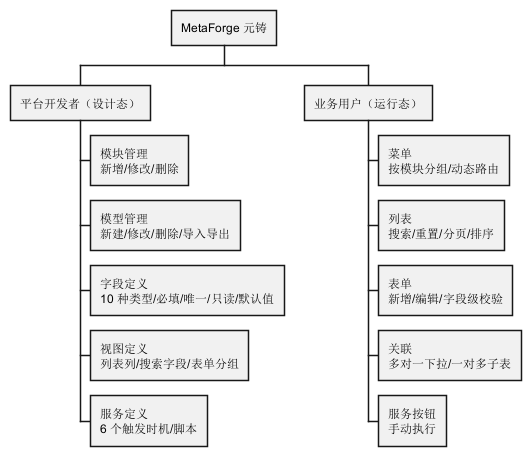


### 3.1.3 分析类图

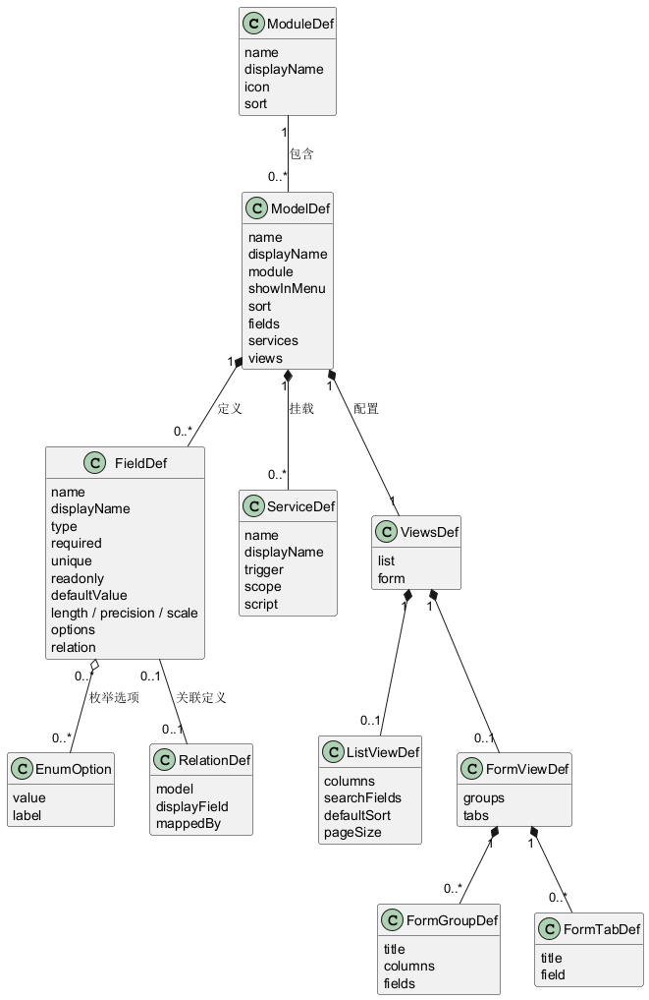

分析类图描述元模型的构成：模块包含模型，模型包含字段、服务和视图，字段通过关系定义指向另一个模型。


### 3.1.4 数据库设计

**元模型表**（两张，结构固定）：

| 表 | 列 | 说明 |
|---|---|---|
| `meta_module` | `name`（PK）、`display_name`、`icon`、`sort` | 模块 |
| `meta_model` | `name`（PK）、`module_name`、`definition`（JSON）、`created_at`、`updated_at` | 每个模型一整份定义（决策 001） |

: 表 3-1 数据库设计


**业务表**：每个模型一张真实表，表名 `md_{模型名}`，字段名与模型字段一致，另加系统字段 `id`（自增主键）、`created_at`、`updated_at`。字段类型到列类型的映射由 `FieldTypeHandler` 的实现类决定：

| 字段类型 | 列类型 | 附加约束 |
|---|---|---|
| string / text | `VARCHAR(n)` / `TEXT` | 唯一字段建唯一索引 |
| integer | `INT` | — |
| decimal | `DECIMAL(p,s)` | — |
| boolean | `TINYINT(1)` | — |
| date / datetime | `DATE` / `DATETIME` | — |
| enum | `VARCHAR(n)` | 存枚举的 value |
| manyToOne | `BIGINT` | 存目标记录 id，**不建外键**（决策 009） |
| oneToMany | 不落列 | 通过子表的 mappedBy 字段反查 |

: 表 3-2 数据库设计


### 3.1.5 接口设计

元模型接口 `/api/meta/*`、数据接口 `/api/data/{model}/*`、服务接口 `/api/svc/{model}/{service}` 的完整定义见 [`docs/contract/api.md`](../contract/api.md)，本章不重复。

## 3.2 详细设计

### 3.2.1 后端核心类图

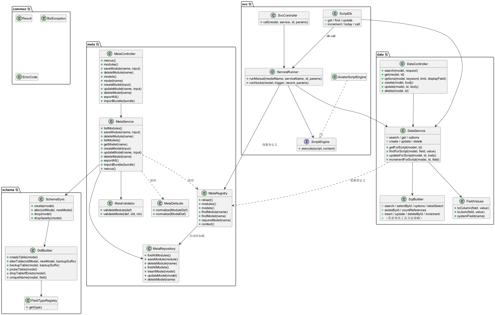

图中的包名省略了 `com.metaforge.` 前缀：`meta` = `com.metaforge.meta`，`schema` = `com.metaforge.schema`，`data` = `com.metaforge.data`，`svc` = `com.metaforge.svc`，`common` = `com.metaforge.common`。虚线表示“使用/实现”，实线表示“依赖/聚合”。


### 3.2.2 字段类型策略类图

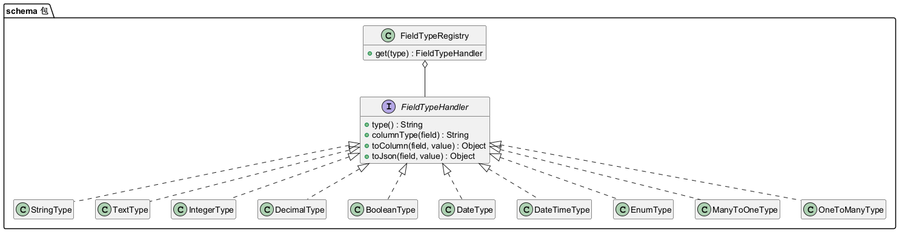

字段类型的差异收敛在一个接口上：每种类型负责自己的列类型和值转换，新增类型只加一个实现类并在 `FieldTypeRegistry` 注册。


> 前端有一张对称的注册表 `fields/index.ts`（字段类型 → 组件），两边靠 `docs/contract/meta-model.md` 的类型名对齐。

### 3.2.3 时序图一：开发者保存一个模型

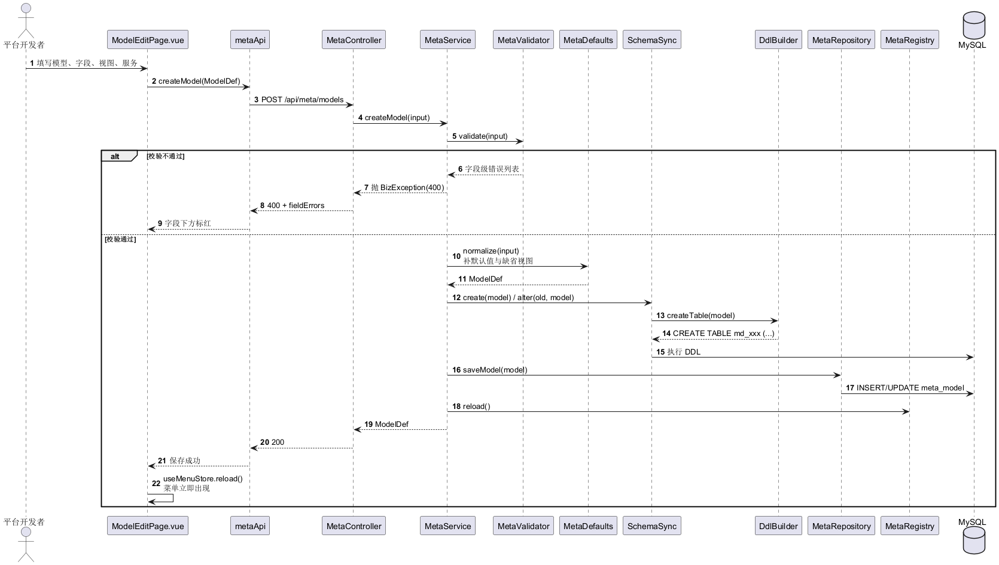


**为什么先执行 DDL 再保存定义**：DDL 不能回滚。先建表，建表失败时元模型还停留在旧版本；如果先存定义再建表，失败就会留下“定义里有、库里没有”的状态（决策 005）。

### 3.2.4 时序图二：业务用户查询一页数据

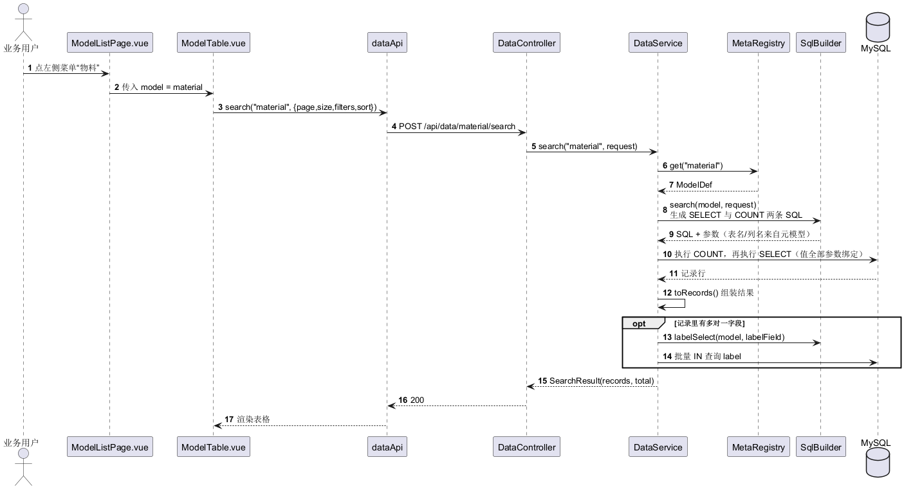


### 3.2.5 活动图：新建一条记录

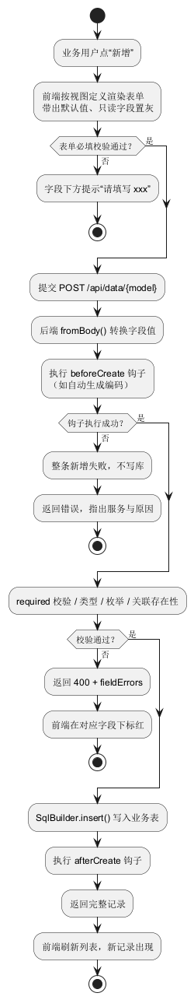


> 钩子在必填校验之前执行，和 `DataService.create()` 的实际顺序一致：`fromBody()` → `beforeCreate()` → `requireRequired()` → `validateRelations()` → 写库 → `afterCreate()`。

## 3.3 设计说明

| 设计点 | 选择 | 理由 |
|---|---|---|
| 元模型存储 | 每个模型一份 JSON（`definition` 列） | 定义总是整体读写，拆表后读一个模型要多次关联（决策 001） |
| 业务数据存储 | 每个模型一张真实表 | 搜索、排序、分页、唯一约束直接用数据库能力（决策 002） |
| 通用接口 | 一个 `DataController`，模型名作路径变量 | 新增模型不需要新增控制器（决策 003） |
| SQL 安全 | 表名列名只取自校验过的元模型，值全部参数绑定 | 元模型是唯一可信来源，请求里的字符串不进 SQL（决策 004） |
| 删字段/删模型 | 改名成 `zz_` 前缀留备份 | DDL 不可回滚，改名是毫秒级且数据可恢复（决策 005） |
| 脚本引擎 | AviatorScript 5.4.4 + 受控 `db` 函数 | 依赖 0.6 MB、冷启动约 11 ms、执行 1000 次约 38 ms；内置沙箱与超时，Groovy 体积和冷启动都大一个量级（决策 006） |
| 关联关系 | 多对一返回 `{id,label}`、不级联保存、不建外键 | 列表无需二次查询；外键会挡住“改名留备份”的改表方式（决策 009） |

: 表 3-3 设计说明


# 4 项目实现

本章分后端、前端两部分，由两位开发同学分别撰写，文档同学统稿。每个关键功能配界面截图，截图取自真实的`metaforge_d5`环境。

## 4.1 后端实现

> 本章说明 MetaForge 后端（`backend/`）的实现。后端对应任务 B1–B6：元模型存取、动态建表、通用数据接口、关联关系、脚本服务、热加载和导入导出。核心原则是「模型驱动」：业务表、接口和校验都由运行时下发的元模型决定，代码里不写死物料、产品等具体模型。

### 4.1.1 技术栈与分层

| 类别 | 选型 | 说明 |
|---|---|---|
| 框架 | Spring Boot 4.0.5 | 单体后端，内嵌 Tomcat |
| 语言 | Java 21 | record、switch 表达式、文本块 |
| 数据库 | MySQL 9.6.0 | 元模型表 `meta_*`、业务表 `md_*`、备份表 `zz_*` |
| 数据访问 | `NamedParameterJdbcTemplate` | 动态 SQL，值全部命名参数绑定 |
| JSON | Jackson 3（`tools.jackson`） | Spring Boot 4 默认 |
| 测试 | JUnit 5 + H2 + MockMvc | 不依赖 MySQL 的接口测试 |
| 脚本 | AviatorScript 5.4.4 | B5 服务引擎，sandbox 执行 |

: 表 4-1 技术栈与分层


#### 4.1.1.1 目录与分层

```text
backend/src/main/java/com/metaforge/
├─ common/        Result、BizException、ErrorCode、GlobalExceptionHandler
├─ health/        HealthController
├─ meta/          MetaController、MetaService、MetaRegistry、
│                  MetaRepository、MetaValidator、MetaDefaults
├─ schema/        SchemaSync、DdlBuilder、FieldTypeRegistry、types/*
├─ data/          DataController、DataService、SqlBuilder、FieldValues
└─ svc/           SvcController、ServiceRunner、ScriptEngine、
                   AviatorScriptEngine、ScriptDb、ScriptContext
```

一次请求的调用链：

```text
浏览器 /api/...
  → Controller
  → Service（MetaService / DataService / ServiceRunner）
  → MetaRegistry（当前模型定义）
  → SqlBuilder / FieldValues（生成 SQL、转换字段值）
  → NamedParameterJdbcTemplate
  → MySQL
```

Controller 只做转发，不写业务规则；模型定义统一从 `MetaRegistry` 取，所以新增模型或字段后不需要为每个模型写新的 Controller。

### 4.1.2 元模型存储与注册表

#### 4.1.2.1 每个模型存一份 JSON

元模型存在两张表：

- `meta_module`：模块标识、显示名、图标、排序；
- `meta_model`：模型标识、所属模块、完整定义的 JSON、排序等。

每个模型的字段、服务、视图一起存成一份 JSON。这样读一个模型只需要一次查询，修改时也不会有多张表之间的一致性问题；字段数量不大，不需要拆成字段表。代价是不能直接用 SQL 按字段查询元模型，但平台的元模型操作都是“整份读取、整份校验、整份替换”，这个代价可以接受。对应决策 001。

#### 4.1.2.2 `MetaRegistry` 用整份快照

`MetaRegistry` 在内存里保存一份不可变快照：

```java
private record Snapshot(Map<String, ModuleDef> modules, Map<String, ModelDef> models) {}

private volatile Snapshot snapshot = new Snapshot(Map.of(), Map.of());

public void reload() {
    // 从 MetaRepository 读全部模块和模型，排好序后一次性替换
    snapshot = new Snapshot(modules, models);
}
```

所有数据接口都通过 `registry.requireModel(name)` 取当前定义。`reload()` 是整份替换，读的人要么看到旧的一整份，要么看到新的一整份，不会看到“模型改了一半”的中间状态。

#### 4.1.2.3 写库和刷新内存的顺序

保存模型的顺序固定为：

```text
校验 → 写数据库 → MetaRegistry.reload() → 返回
```

数据库是唯一事实来源，内存只是缓存。写库失败就不刷新；刷新失败时数据库已经是新定义，当前内存保留旧快照，下一次成功的 reload 会恢复一致。没有采用“先改内存再写库”，否则写库失败时内存里会存在数据库里没有的模型。

### 4.1.3 动态建表与字段类型

#### 4.1.3.1 `SchemaSync` 和 `DdlBuilder`

`MetaService.createModel()` 在保存模型定义之前，会调用 `SchemaSync.create(model)` 建业务表；修改模型时调用 `SchemaSync.alter(old, new)` 改表；删除模型时把表改名成 `zz_` 前缀留备份，不直接 `DROP`。

`SchemaSync` 负责执行和补偿，`DdlBuilder` 只负责生成 DDL 字符串：

- 表名统一 `md_` 前缀；
- 每个字段由对应的 `FieldTypeHandler` 给出列类型；
- 唯一字段生成 `uk_模型_字段` 约束；
- 修改模型时按字段差异生成 `ADD COLUMN`，删字段时改名为备份列；
- 建表、改表语句在事务外执行，因为 MySQL DDL 不能回滚。

#### 4.1.3.2 字段类型处理器

字段类型采用策略模式。`FieldTypeHandler` 定义四件事：

```java
String type();
String columnType(FieldDef field);
Object toColumn(FieldDef field, Object value); // JSON → 数据库
Object toJson(FieldDef field, Object value);   // 数据库 → JSON
```

`FieldTypeRegistry` 按类型名查找处理器，启动时检查契约里的 10 种类型是否都注册了。新增一种字段类型只需要加一个实现类并登记一行，不需要在 `DataService` 里写 `if (type 是 ...)`。

#### 4.1.3.3 DDL 的固有限制

建表、改表不能回滚，所以：

- 导入时先校验整个包，校验不过不执行任何 DDL；
- 如果新建表成功但写定义失败，代码会把这次新建的表删掉；
- 如果老表 `ALTER TABLE` 改到一半失败，数据库无法自动还原，只能靠导入前备份。这个限制写在决策 010 里，不假装导入是 100% 原子的。

### 4.1.4 通用数据接口与 SQL 安全

#### 4.1.4.1 一个控制器服务所有模型

`DataController` 的路径是 `/api/data/{model}`，模型名是路径变量：

- `POST /api/data/{model}/search`：分页查询；
- `GET /api/data/{model}/{id}`：详情；
- `GET /api/data/{model}/options`：多对一下拉；
- `POST /api/data/{model}`：新建；
- `PUT /api/data/{model}/{id}`：修改；
- `DELETE /api/data/{model}/{id}`：删除。

新增模型后，只要定义进了 `MetaRegistry`，这些接口立刻可用，不需要重启，也不需要为模型注册新的映射。

#### 4.1.4.2 固定的写入流程

`DataService` 把新建、修改、删除写成模板方法：

```text
新建：fromBody → beforeCreate 钩子 → 必填 → 关联校验 → INSERT
      → afterCreate 钩子 → 读回
修改：fromBody → beforeUpdate 钩子 → 必填 → 关联校验 → UPDATE
      → afterUpdate 钩子 → 读回
删除：引用检查 → beforeDelete 钩子 → DELETE
```

钩子放在 `DataService` 而不是每个 Controller 里，保证不会出现“某个接口忘了调钩子”。事务覆盖钩子、写库和读回：脚本出错时整次操作回滚。

`fromBody` 只接受模型定义里存在的字段；系统字段传了会被忽略；没传的字段新建时取默认值，修改时保留原值；类型、长度、枚举、多对一目标是否存在等错误会收集成 `fieldErrors` 一起返回。

#### 4.1.4.3 四道 SQL 防线

表名和列名不能作为 JDBC 参数，必须拼进 SQL，所以 `SqlBuilder` 用四道规则防注入（决策 004）：

1. 表名、列名只从模型定义里取；请求里的字段名只用来在定义里查找，查不到返回 400。
2. 值一律用 `:name` 命名参数绑定，不拼字符串。
3. 比较方式、排序方向用 `switch` 映射成固定写法，未知值返回 400。
4. 拼进 SQL 前再用标识正则检查一遍并加反引号。

`SqlBuilderTest` 对非法字段名、非法排序方向、`in`/`like` 参数等边界单独测试；`DataApiTest` 从 HTTP 层验证注入字符串只会被当成普通值。

### 4.1.5 关联关系

多对一字段在数据库里存目标记录的 id，不建数据库外键（决策 009）。原因：

- 业务表是运行时建的，外键会增加建表/改表的复杂度；
- 删除保护需要在应用层给出“被哪个模型、哪个字段、多少条引用”的中文提示，数据库外键给不了；
- 批量读取时用一次 `IN` 查询取 label，比逐条查或直接 `JOIN` 更适合通用列表。

写入时，`DataService` 检查目标记录是否存在；删除前，`MetaRegistry` 找出所有指向本模型的 `manyToOne` 字段，逐个查引用，有引用返回 409。读出时，同一页同一个关联字段的 id 收集起来，用一条 `IN` 查询取回 id 和显示字段，再组装成：

```json
{ "id": 3, "label": "螺丝 M3" }
```

一对多不级联保存：产品表单里的 BOM 明细直接调 `product_bom` 的数据接口，子表记录单独增删改。这样产品保存和 BOM 保存不会绑成一个巨大的事务，错误定位也更简单。

### 4.1.6 脚本服务引擎（B5）

#### 4.1.6.1 接口与实现分离

业务代码只依赖 `ScriptEngine`：

```java
public interface ScriptEngine {
    Object execute(String script, ScriptContext context);
}
```

`AviatorScriptEngine` 是当前实现。以后换引擎只需要换实现和配置，`ServiceRunner`、`DataService` 不用改。决策 006 比较了 Groovy 和 AviatorScript：Aviator 依赖 0.6 MB、冷启动约 11 ms、1000 次执行约 38 ms，并且内置 sandbox、执行超时和循环上限；Groovy 脚本更接近 Java，但依赖 7.4 MB，沙箱和超时要自己补。

#### 4.1.6.2 只给受控的 `db`

脚本不能拿 `JdbcTemplate`、JDBC 或任意 Java 类。`ScriptDb` 只暴露这些方法：

| 方法 | 用途 |
|---|---|
| `db.get(model, id)` | 按 id 读一条 |
| `db.find(model, field, value)` | 按字段精确找第一条 |
| `db.update(model, id, values)` | 按 id 修改，走和普通修改一样的校验，但不触发目标模型钩子 |
| `db.increment(model, id, field)` | 整数原子加 1 并返回新值 |
| `db.today(pattern)` | 按格式返回当天日期 |
| `db.call(model, service, id, params)` | 调另一个 manual 服务 |

: 表 4-2 只给受控的 `db`


这里有两个有意的限制：

- `db.update` / `db.increment` 不触发目标模型的钩子，避免脚本里的写操作递归触发同一个钩子；
- `db.call` 只能调 `manual` 服务，调用链检测环，防止服务互相调用死循环。

#### 4.1.6.3 生命周期钩子和事务

`DataService` 在新建/修改/删除的前后调用 `ServiceRunner.runHooks`，按定义顺序执行对应 `trigger` 且启用的服务：

- `beforeCreate` / `beforeUpdate` 可以修改 `record`，修改后的值会写进数据库；
- `beforeDelete` 里 `throw` 可以阻止删除；
- `afterCreate` / `afterUpdate` 在写库之后执行，出错时整个事务回滚。

`ServiceRunner.runManual` 带 `@Transactional`；脚本通过 `db` 调 `DataService` 时走同一个事务。脚本语法错误、运行时错误和 `throw` 都会转成 400，`message` 带服务名和原因。

#### 4.1.6.4 并发编码

编码规则的 `generate` 不能“先查 current_serial 再加 1”，否则两个请求会拿到同一个值。`db.increment` 执行的是：

```sql
UPDATE `md_code_rule`
SET `current_serial` = `current_serial` + 1
WHERE `id` = :id
```

先拿行锁，再在同一个事务里读回新值。`ServiceApiTest` 用 20 个线程同时新建物料，验证得到 20 个互不重复的编码；真实 MySQL 上也跑过同样场景。

### 4.1.7 热加载和导入导出（B6）

#### 4.1.7.1 保存后立刻生效

`MetaService` 在写库成功后调用 `MetaRegistry.reload()`；前端 F5 保存模型后调用 `useMenuStore.reload()`，重新请求 `/api/meta/menus` 并按新菜单注册路由。因此：

- 新建模型后菜单立刻出现；
- 给模型加字段后，数据接口下一次请求就能读写新字段；
- 不需要重启后端，也不需要刷新整个页面。

#### 4.1.7.2 导入的三步

`MetaService.importBundle` 的顺序：

1. **校验整个包**：模块、模型、字段、关联、服务、视图全部过 `MetaValidator`；任何一处错就整个拒绝，此时还没动数据库。
2. **建表/改表**：新模型建表，已有模型按差异改表。
3. **写定义**：模块和模型定义放在一个事务里，全部成功或全部不写。

新建表后写定义失败，会把这次新建的表删掉；老表 `ALTER` 失败无法完全还原，导入前要备份。这个限制和“多实例时每个进程各有一份快照”的问题写在决策 010。

### 4.1.8 测试和验证

后端测试分三层：

- `SqlBuilderTest`、`DdlBuilderTest`：只测字符串生成，不连数据库；
- `MetaApiTest`、`DataApiTest`、`RelationApiTest`：用 H2 + MockMvc 测接口；
- `ServiceApiTest`：测 B5 服务、钩子、事务回滚、热更新、`db.update`、`beforeDelete` 和 20 并发。

全量 119 个测试通过。真实 MySQL 9.6.0 上还验证过：

- 导入 `mes.json`、动态建表和 CRUD；
- 编码规则生成 `MAT-20261120-0001` 这类编码；
- 20 并发新建物料得到 20 个唯一编码；
- `misc-1123-*` 联调 2 的五条验收。

### 4.1.9 关键取舍和反思

| 取舍 | 选择 | 代价 |
|---|---|---|
| 元模型存储 | 每个模型一份 JSON | 不能按字段直接查元模型 |
| 数据访问 | `NamedParameterJdbcTemplate` | 手写映射和 SQL，防注入要自己负责 |
| 关联 | 应用层校验，不建外键 | 删除/写入检查代码更多 |
| 一对多 | 子表单独增删改 | 前端要维护标签页，保存不是一次完成 |
| 服务 | Aviator + 受控函数 | 脚本语法要学，不能直接把 Java 对象给脚本 |
| 导入 | 先校验、DDL 后事务写定义 | DDL 不能回滚，极限情况要备份恢复 |

: 表 4-3 关键取舍和反思


AI 在这个项目里主要做了三件事：生成骨架和重复代码、比较技术方案、写测试。它也犯过错：最初把“MyBatis-Flex 依赖实体类”说得过绝对，核对文档后修正为“可以用 Db+Row，但在动态模型场景收益不够”；服务引擎选型也先建议 Groovy，试做后改为 Aviator。这些选择最后由组长确认，决策记录里保留了“为什么改”的过程。

### 4.1.10 小结

后端的关键不是“写一个万能接口”，而是把“模型定义”变成可校验、可建表、可查询、可执行脚本的运行时数据：

- `MetaRegistry` 提供当前定义快照；
- `DdlBuilder` / `SchemaSync` 把定义变成表；
- `SqlBuilder` / `DataService` 把定义变成安全的 CRUD；
- `ServiceRunner` / `AviatorScriptEngine` 把定义里的脚本变成可执行服务；
- `MetaService` 负责保存、导入导出和刷新内存。

这条链路打通后，新增一个模型只需要在设计器里定义，不需要改一行后端代码，也不需要重启。


## 4.2 前端实现

> 本章说明 MetaForge 前端（`frontend/`）的实现。前端是一个 Vue 3 单页应用，核心思想是「模型驱动」：页面不写死任何业务模型，菜单、列表、表单、字段控件全部来自运行时下发的模型定义。

### 4.2.1 技术栈

| 类别 | 选型 | 说明 |
|---|---|---|
| 框架 | Vue 3（组合式 API + `<script setup lang="ts">`） | 全部组件用组合式 API |
| 语言 | TypeScript（严格模式） | 下标访问需判空 |
| UI 组件库 | Ant Design Vue 4 | 全局注册，模板直接用 `a-xxx` |
| 图标 | `@ant-design/icons-vue` | 按需 import |
| 状态管理 | Pinia | `menu`、`model` 两个 store |
| 路由 | Vue Router | 固定路由 + 运行时 `addRoute` 动态注册 |
| 构建 | Vite | 开发时 `/api` 代理到后端 8200 |
| 请求 | axios + dayjs | 统一走 `src/api/request.ts` |

: 表 4-4 技术栈


### 4.2.2 目录结构

```
frontend/src/
├─ main.ts / App.vue            入口，注册 Antd + Pinia + Router + 主题
├─ theme.ts                     全站主题（主色、圆角、字号）
├─ layouts/BasicLayout.vue      深色可折叠侧栏 + 顶栏 + 内容区
├─ pages/
│  ├─ HomePage.vue              首页概览（统计 + 快捷入口 + 环境检查）
│  ├─ ModelListPage.vue         通用列表页（/app/:model）
│  ├─ NotFoundPage.vue          404
│  └─ design/                   平台设计（设计态）
│     ├─ ModuleListPage.vue     模块管理
│     ├─ ModelDesignListPage.vue 模型管理（含导入/导出）
│     └─ ModelEditPage.vue      模型编辑（5 个标签页）
├─ components/
│  ├─ ModelTable.vue            通用「搜索区+工具栏+表格」
│  ├─ ModelForm.vue             通用「抽屉表单 + 子表标签页」
│  └─ fields/                   字段组件（7 个 + 注册表 + 显示规则）
├─ stores/
│  ├─ menu.ts                   useMenuStore（动态路由）
│  └─ model.ts                  useModelStore（模型定义缓存）
├─ api/                         request / meta / data / health
├─ types/                       meta.ts / api.ts
├─ mock/                        前端内存假后端（开发期）
└─ router/index.ts              固定路由 + beforeEach 守卫
```

### 4.2.3 核心模块实现

#### 4.2.3.1 动态路由与菜单（F1）

业务模型的地址（`/app/{模型名}`）不在固定路由表里，而是运行时按 `/api/meta/menus` 的返回逐个注册。

- `stores/menu.ts` 的 `load()` 调 `metaApi.menus()`，对每个叶子节点 `router.addRoute('layout', {...})`，`props.model` 把模型名传给 `ModelListPage`，并记录注册过的路由名。
- `router/index.ts` 的全局前置守卫：首次导航时若菜单未加载，先 `await load()`，再 `return to.fullPath` 让这次导航重新匹配，解决「刷新 `/app/material` 落到 404」的问题。
- `load()` 失败也把 `loaded` 置为 `true`、`menus` 置空，避免守卫死循环。
- `reload()` 先 `removeRoute` 再重载，供 F5 保存模型后刷新菜单使用（决策 007）。

#### 4.2.3.2 通用列表页（F2）

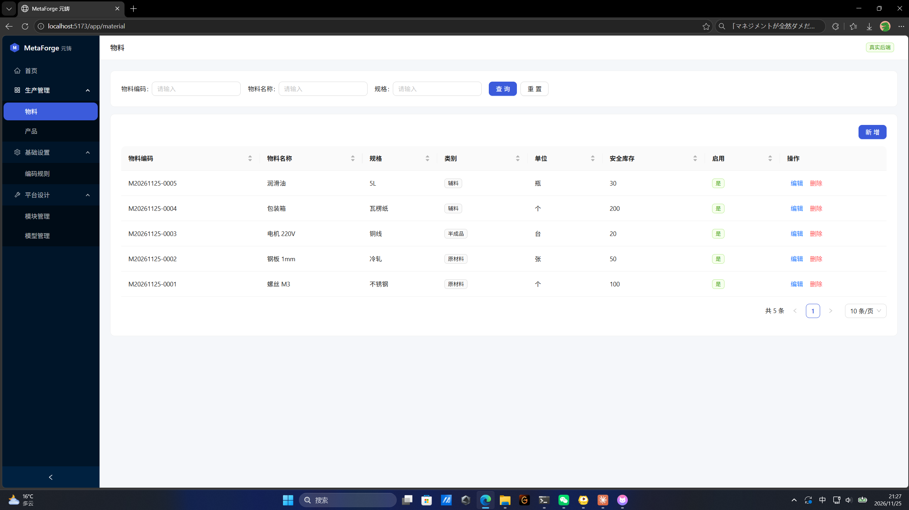

物料、产品、编码规则三套页面共用同一个 `ModelTable.vue`，列和搜索字段都来自模型定义的 `views.list`。

- 列 = `views.list.columns`，标题取字段 `displayName`（系统字段用 `SYSTEM_FIELD_TITLES`），单元格文字由 `displayValue(field, value)` 统一转换（enum→label、boolean→是/否、manyToOne→label、decimal→按 scale 去尾零、空值→—）。
- 搜索区按字段类型选控件（string/text 用 like，enum/boolean/number 用 eq，date/datetime 用范围 ge+le，manyToOne 用可搜索下拉 eq）。
- 查询调 `dataApi.search(model, {page,size,filters,sort})`，排序、分页都交给后端。
- 删除成功提示并刷新；被引用删除时后端 409，前端捕获后保持列表不变（错误提示由 `request.ts` 统一弹）。

#### 4.2.3.3 通用表单（F3）

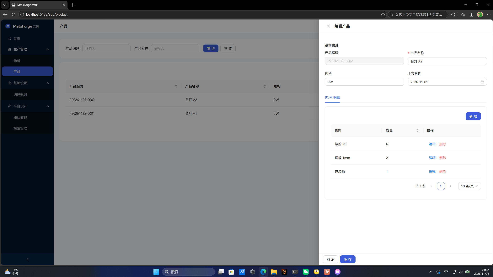

`ModelForm.vue` 是一个 `a-drawer` 抽屉表单，字段按 `views.form.groups` 分组布局，每个字段占 `24/columns` 格。

- 字段类型到输入组件的对应集中写在 `fields/index.ts` 的 `fieldComponents` 注册表，表单统一用 `<component :is>` 渲染，避免一长串 `v-if`（决策 008）。
- 7 个字段组件统一 `modelValue / field / disabled` 三个 props 和 `update:modelValue` 事件，各自处理清空发 null、精度、格式等细节。
- 必填字段加校验规则（boolean 除外）；`readonly` 字段禁用，新建且无值显示「保存后自动生成」。
- 提交时 `manyToOne` 的 `{id,label}` 只提交 `id`；失败捕获 `ApiError`，`fieldErrors` 显示到对应表单项下方。

#### 4.2.3.4 关联字段（F4）

- `ManyToOneField.vue`：可搜索下拉（`show-search` + `filter-option=false`），选项来自 `dataApi.options(relation.model, {keyword, displayField, limit})`，输入带 300ms 防抖；`{id,label}` 能直接回显 label。
- 一对多：`ModelForm` 下方渲染子表标签页（`views.form.tabs`），用 `ModelTable` 以 `fixedFilters=[{field: mappedBy, op:eq, value: recordId}]` 查子表；新建未保存时显示「先保存，再添加明细」。

#### 4.2.3.5 模型设计器（F5）

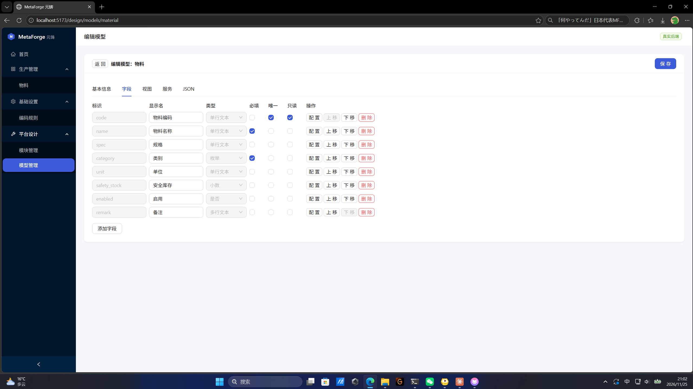

设计态的三个页面：模块管理、模型管理、模型编辑。

- `ModelEditPage.vue` 维护一份 `ModelInput` 草稿，用 5 个标签页（基本信息 / 字段 / 视图 / 服务 / JSON）编辑。
- 新建时 `views` 为 `undefined`（保存后后端按默认规则生成视图）；关闭「使用默认视图」时按默认规则生成一份初始视图。
- 保存前做前端校验（标识规则、字段不重名、enum 有选项、关联选了模型等），通过后调 `createModel`/`updateModel`。
- 保存成功后 `await useMenuStore.reload()`，重新注册动态路由，菜单即时生效（决策 010）。

#### 4.2.3.6 服务按钮与界面美化（F6）

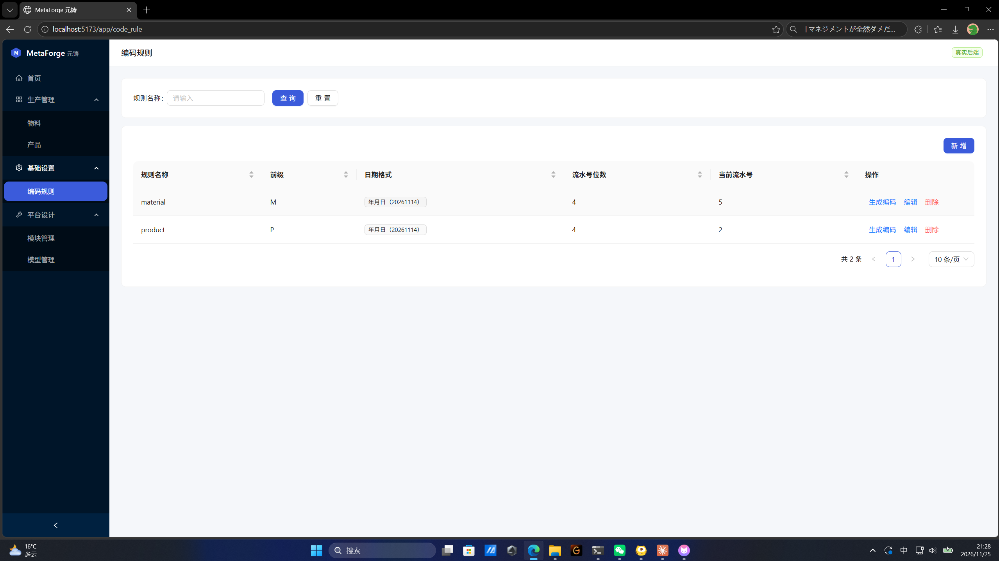

- 从模型定义取 `trigger=manual` 且未禁用的服务：`scope=model` 的显示成工具栏按钮，`scope=record` 的显示成每行操作列按钮；点击调 `callService(model, service, {id})`，结果用弹窗展示（字符串/数字大号字+复制，对象/数组 `<pre>` JSON，空值显示「执行成功」），关闭后刷新列表。
- `theme.ts` 统一定义主色 `#3B5BDB`、圆角 8、字号 14，`App.vue` 用 `a-config-provider :theme` 应用。
- 侧栏深色可折叠 + SVG 标志；首页改成概览（模块数/模型数/字段总数三个统计卡片 + 快捷入口 + 环境检查）。
- 列表搜索区和表格分放两张白卡片，1366 宽度下无横向滚动条。

### 4.2.4 关键设计决策

| 决策 | 选择 | 记录 |
|---|---|---|
| 动态路由 | 按菜单逐个 `addRoute`，不用 `/app/:model` 参数路由 | 007 |
| 视图渲染 | 字段类型 → 组件注册表，不用一长串 v-if | 008 |
| 关联字段 | 多对一读 `{id,label}` 提交只传 id；一对多不级联保存 | 009 |
| 模型改后生效 | 保存后 `useMenuStore.reload()` 重新注册路由 | 010 |

: 表 4-5 关键设计决策


### 4.2.5 小结

前端通过「运行时注册路由 + 通用列表/表单组件 + 字段组件注册表 + 模型设计器」四个机制，实现了不改代码就能支撑任意业务模型的目标；开发期靠 `src/mock` 内存假后端与真实后端保持一致，联调后切 `VITE_USE_MOCK=false` 接真实后端。


# 5 测试

## 5.1 测试范围和方法

- **范围**：功能清单 FR-01 至 FR-29。其中 FR-11（AI 助手）是加分项、不排主线，本期不纳入测试。
- **方法**：黑盒测试，在部署好的真实系统上用界面手工执行，不直接改数据库。每条用例只通过点击菜单、填写表单、点按钮来完成；FR-26 至 FR-28 这类没有独立界面的特性，用能观察到的操作来验证。
- **测试对象**：MES 示例的两个模块、四个模型——生产管理（物料、产品、产品 BOM）、基础设置（编码规则）。
- **数据**：用例需要的数据由用例自己创建，前置条件里写明依赖哪条用例。用例之间不假设系统里已有数据。
- **环境**：Windows 11 专业版（10.0.26200）；Microsoft Edge 157.0.4341.60（备用 Google Chrome 156.0.8078.80）；前端 `http://localhost:5173`（Vite 开发服务器），后端 `http://localhost:8200`；后端 Spring Boot 4.0.5、OpenJDK 21.0.11；数据库 MySQL 9.6.0。

## 5.2 测试用例

### 5.2.1 基础数据

测试前先清空数据库，只导入 `mes.json`，确认库里是 2 个模块、4 个模型，再开始执行用例。

测试前系统里已按 `docs/contract/samples/mes.json` 配好 MES 示例（两个模块、四个模型），这是 D5 的产出，测试直接使用。

为了避免污染示例数据，FR-01、FR-02、FR-03、FR-04、FR-08 的用例用一个临时模块 `test` 和临时模型 `test_obj` 验证。用例按编号顺序执行，后面用例引用的数据都由前面已执行的用例创建。

| 编号 | 功能编号 | 测试项 | 前置条件 | 操作步骤 | 预期结果 | 实际结果 | 是否通过 | 备注 |
|---|---|---|---|---|---|---|---|---|
| TC-01 | FR-01 | 新增模块 | 已登录，能进入平台的设计器 | 1. 打开“模块管理”；2. 点“新增”；3. 标识填 `test`，显示名填“测试模块”，图标任选，排序填 99；4. 点“保存” | 模块列表出现“测试模块”；新建模型时“所属模块”能选到它 | 与预期一致 | 通过 | |
| TC-02 | FR-01 | 删除还有模型的模块被拒绝 | TC-01 已建“测试模块”，TC-03 已在其下建模型“测试模型” | 1. 打开“模块管理”；2. 找到“测试模块”，点“删除”；3. 确认框点“确定” | 删除失败，提示该模块下还有模型；模块仍在列表中 | 与预期一致 | 通过 | 出错情形 |
| TC-03 | FR-02 | 新建模型 | TC-01 | 1. 打开“模型管理”；2. 点“新建模型”；3. 标识填 `test_obj`，显示名填“测试模型”，所属模块选“测试模块”；4. 保存 | 模型列表出现“测试模型”，标识为 `test_obj` | 与预期一致 | 通过 | |
| TC-04 | FR-02 | 模型标识不合规时当场提示 | TC-01 | 1. 点“新建模型”；2. 标识填 `Test-Obj`（含大写字母和横线）；3. 点“保存” | 标识字段下方提示不合规（须以小写字母开头，只含小写字母、数字、下划线，最长 30 位），模型未创建 | 与预期一致 | 通过 | 出错情形 |
| TC-05 | FR-03 | 定义字段的十种类型 | TC-03 | 1. 打开“测试模型”的字段定义；2. 依次添加：`code` 单行文本、`name` 单行文本、`spec` 单行文本、`remark` 多行文本、`stock` 整数、`safety_stock` 小数、`enabled` 是否、`launch_date` 日期、`launch_time` 日期时间、`category` 枚举；3. 保存 | 字段类型下拉中共有 10 种类型；本次添加的 10 个字段保存成功，对应表结构建立 | 与预期一致 | 通过 | 多对一、一对多分别在 TC-30、TC-31 验证 |
| TC-06 | FR-03 | 字段属性：必填、唯一、只读、默认值 | TC-05 | 1. 编辑“测试模型”字段：`name` 勾“必填”，`code` 勾“唯一”和“只读”，`safety_stock` 默认值填 0，`enabled` 默认值选“是”；2. 保存；3. 打开测试模型的列表点“新增” | 保存成功；新增表单中“名称”带必填标记，“编码”不可编辑，“安全库存”预填 0，“启用”默认选中“是” | 与预期一致 | 通过 | |
| TC-07 | FR-04 | 枚举字段没有选项时不能保存 | TC-05 | 1. 编辑“测试模型”的 `category` 字段；2. 删除全部选项；3. 点“保存” | 提示枚举字段至少要有一个选项，保存失败，原选项保留 | 与预期一致 | 通过 | 出错情形 |
| TC-08 | FR-05 | 配置列表视图的列和顺序 | 物料已有字段（TC-05、TC-06） | 1. 打开“物料”的视图配置；2. 列表视图勾选 `code`、`name`、`category` 三列，顺序调为编码→名称→类别；3. 保存；4. 打开物料列表页 | 列表按“物料编码、物料名称、类别”的顺序显示这三列 | 与预期一致 | 通过 | |
| TC-09 | FR-05 | 不配置视图时自动生成默认视图 | TC-03 | 1. 新建模型，标识填 `tmp_obj`、显示名“临时对象”，只加 `name` 一个字段，不做任何视图配置；2. 保存后打开它的列表页和新增表单 | 列表页自动显示字段列，新增表单自动生成，无需手工配置视图 | 与预期一致 | 通过 | |
| TC-10 | FR-06 | 定义服务并选择触发时机 | 物料模型存在 | 1. 打开“物料”→“服务”；2. 新增服务，名称 `fill_code`，显示名“自动生成物料编码”，触发时机选“新增前”，脚本先填占位内容；3. 保存 | 服务列表出现 `fill_code`，触发时机显示“新增前” | 与预期一致 | 通过 | 脚本引擎（决策 006）B5 定稿后补具体脚本；本条只验证服务定义与触发时机 |
| TC-11 | FR-07 | 保存模型后菜单立即出现 | 已登录，停留在任意页面（不要刷新） | 1. 新建模型，标识填 `supplier`、显示名“供应商”，只加 `name` 一个字段，模块选“生产管理”；2. 保存后不刷新页面，看左侧菜单 | 左侧“生产管理”下立即出现“供应商”，点击能进入列表页 | 与预期一致 | 通过 | |
| TC-12 | FR-08 | 新增字段立即可用且已有数据不丢 | TC-05 已建“测试模型”；先在它的列表新增一条记录，名称填“原始记录” | 1. 编辑“测试模型”，新增字段 `extra_spec`（单行文本，显示名“补充规格”）；2. 保存；3. 不刷新页面打开测试模型列表；4. 打开“原始记录” | 列表能显示新字段；已有记录仍在，新字段值为空 | 与预期一致 | 通过 | |
| TC-13 | FR-08 | 修改已保存字段的类型被拒绝 | “测试模型”已有 `spec` 字段（TC-05） | 1. 编辑 `spec` 字段；2. 把类型从“单行文本”改为“整数”；3. 点“保存” | 保存被拒绝，提示已保存字段的类型不能修改；字段类型仍为单行文本 | 与预期一致 | 通过 | 出错情形 |
| TC-14 | FR-09 | 删除被引用的模型被拒绝 | 产品 BOM 的 `material` 字段关联物料，产品的 `bom_lines` 关联产品 BOM | 1. 打开“模型管理”；2. 找到“物料”，点“删除” | 删除失败，提示被“产品 BOM”的“物料”字段引用；物料仍在 | 与预期一致 | 通过 | 出错情形 |
| TC-15 | FR-10 | 导出元模型 | 已有 2 个模块、4 个模型 | 1. 在设计器点“导出”；2. 保存下载的文件 | 得到一个 JSON 文件，包含 2 个模块和 4 个模型的字段、视图、服务 | 与预期一致 | 通过 | |
| TC-16 | FR-10 | 导入元模型恢复 | 先删除“编码规则”模型（TC-15 已导出） | 1. 删除“编码规则”模型；2. 点“导入”，选择 TC-15 导出的 JSON；3. 确认 | 提示处理了 2 个模块、4 个模型；菜单中重新出现“编码规则”，能新增记录 | 与预期一致 | 通过 | |
| TC-17 | FR-12 | 刷新后仍停留在当前模型页 | 已登录 | 1. 左侧点“物料”进入列表页，地址为 `/app/material`；2. 按 F5 刷新 | 刷新后仍停留在物料列表页，不跳首页，不出现 404 | 与预期一致 | 通过 | |
| TC-18 | FR-13 | 列表里枚举、是否、关联字段的显示 | 先新增物料“螺丝 M3”（类别选“原材料”，启用保持“是”）；再新增产品“电动螺丝刀”，并在它的“BOM 明细”里加一条：物料“螺丝 M3”、数量 4 | 1. 打开物料列表；2. 打开产品列表；3. 在产品表单的“BOM 明细”标签页查看明细 | 类别显示“原材料”而不是 `raw`；启用显示“是”而不是 `true`；BOM 的产品、物料列显示名称而不是 id | 与预期一致 | 通过 | |
| TC-19 | FR-14 | 文本搜索模糊匹配 | 用“新增”逐条录入三条物料，名称分别是“螺丝 M3”“螺丝 M4”“主板”，类别都选“原材料” | 1. 在物料列表搜索框的名称栏输入“螺丝”；2. 点搜索 | 返回“螺丝 M3”“螺丝 M4”两条，不包含“主板” | 与预期一致 | 通过 | |
| TC-20 | FR-14 | 枚举精确匹配与重置 | 同 TC-19 | 1. 类别选“原材料”后搜索；2. 点“重置” | 第一次只返回类别为原材料的记录；重置后恢复显示全部记录，搜索条件被清空 | 与预期一致 | 通过 | |
| TC-21 | FR-15 | 分页 | 物料中已有 12 条记录：在 TC-19 的三条基础上，再新增 9 条，名称填“测试物料 4”至“测试物料 12” | 1. 打开物料列表；2. 看分页区并翻到第 2 页 | 每页 10 条、共 2 页；第 2 页显示剩余记录 | 与预期一致 | 通过 | |
| TC-22 | FR-15 | 点击列头排序 | 物料有 3 条以上记录 | 1. 打开物料列表；2. 点“物料名称”列头；3. 再点一次 | 第一次按名称升序，第二次按降序，列表顺序随之变化 | 与预期一致 | 通过 | |
| TC-23 | FR-16 | 新增记录：表单分组并带出默认值 | 物料表单已配置分组（TC-08 或按示例配置） | 1. 物料列表点“新增”；2. 名称填“螺丝 M3”，规格填“M3×8”，类别保持“原材料”；3. 保存 | 表单按“基本信息/其它”分组；单位预填“个”、安全库存预填 0、启用预选“是”；保存成功，列表出现新记录 | 与预期一致 | 通过 | |
| TC-24 | FR-17 | 必填字段未填时的提示 | 物料已存在 | 1. 物料列表点“新增”；2. “物料名称”留空；3. 点“保存” | “物料名称”下方提示必填，记录未保存 | 与预期一致 | 通过 | 出错情形 |
| TC-25 | FR-18 | 唯一字段重复时的提示 | 尚未创建编码规则；若已存在名为 `material` 的规则，第二条改用其它已存在的名称 | 1. 打开“基础设置→编码规则”，新增规则：名称填 `material`、前缀填 `MAT-`、日期格式选“年月日（20261114）”、流水号位数填 4，保存；2. 再点“新增”，规则名称同样填 `material`，其余随意；3. 保存 | 第 1 条保存成功；第 2 条在“规则名称”下方提示“已存在”，记录未保存 | 与预期一致 | 通过 | 出错情形 |
| TC-26 | FR-19 | 只读字段不能填写 | 物料有只读字段 `code` | 1. 打开物料“新增”表单；2. 查看“物料编码”输入框 | “物料编码”不可编辑（置灰或只读），无法手工输入 | 与预期一致 | 通过 | |
| TC-27 | FR-20 | 编辑记录带出原值并更新列表 | 已有物料“螺丝 M3” | 1. 物料列表中该行点“编辑”；2. 把规格改为“M3×10”；3. 保存 | 表单带出原值；保存后列表该行规格显示“M3×10” | 与预期一致 | 通过 | |
| TC-28 | FR-21 | 删除记录需要确认 | 有一条可删除的物料（如“螺丝 M4”） | 1. 该行点“删除”，确认框点“取消”；2. 再点“删除”，点“确定” | 取消后记录仍在；确认后记录从列表消失 | 与预期一致 | 通过 | |
| TC-29 | FR-21 | 删除被引用的记录被拒绝 | 新增产品“电动螺丝刀”，并在它的“BOM 明细”里加一条：物料“螺丝 M3”、数量 4（TC-18 已建过则可直接用） | 1. 打开物料列表；2. 对“螺丝 M3”点“删除”并确认 | 删除失败，提示被“产品 BOM”的记录引用；记录仍在 | 与预期一致 | 通过 | 出错情形 |
| TC-30 | FR-22 | 多对一字段用可搜索下拉框选择 | 已有产品“电动螺丝刀”（在产品列表点“新增”，名称填“电动螺丝刀”后保存）；已有物料“螺丝 M3”（TC-19 创建） | 1. 从产品表单的“BOM 明细”标签页点新增；2. 点“物料”下拉框；3. 输入“螺丝”；4. 选中“螺丝 M3”；5. 数量填 4；6. 保存 | 下拉框可按关键字筛选；选中后显示“螺丝 M3”；保存后 BOM 明细出现这一行 | 与预期一致 | 通过 | |
| TC-31 | FR-23 | 在产品表单下维护 BOM 子表 | 已有产品“电动螺丝刀”（TC-30 创建） | 1. 编辑“电动螺丝刀”；2. 切到“BOM 明细”标签页；3. 新增一行：物料“主板”，数量 1；4. 保存 | 标签页内能增删改子记录；保存后 BOM 明细出现主板一行 | 与预期一致 | 通过 | |
| TC-32 | FR-23 | 未保存的产品不能添加子记录 | 无 | 1. 产品列表点“新增”；2. 名称填“测试产品”；3. 不保存，直接点“BOM 明细”里的新增 | 提示需先保存产品，或新增按钮不可用；子记录未创建 | 与预期一致 | 通过 | 出错情形 |
| TC-33 | FR-24 | 手动服务显示为按钮并返回结果 | 已有编码规则 `material`（TC-25 创建，前缀 `MAT-`、日期格式“年月日”、位数 4） | 1. 打开编码规则列表；2. 找到 `material` 这一行，点“生成编码”按钮 | 显示生成的编码，形如 `MAT-20261115-0001`；再次点击时流水号递增 | 与预期一致 | 通过 | |
| TC-34 | FR-25 | 新增物料时自动生成编码 | 编码规则 `material` 存在（TC-25 创建）；物料已有“新增前”服务（TC-10） | 1. 物料列表点“新增”；2. 只填名称“螺丝 M3”、类别“原材料”；3. 保存 | 保存成功，列表中该物料的编码自动生成，形如 `MAT-20261115-0001`，且不与已有记录重复 | 与预期一致 | 通过 | 依赖 TC-10 的服务脚本，B5 定稿后才能执行 |
| TC-35 | FR-26 | 修改元模型后不重启、不刷新即生效 | 系统正在运行（前后端均已启动） | 1. 新建模型“仓库”，只加 `name` 字段；2. 保存；3. 不重启后端、不刷新页面，直接点左侧新菜单；4. 新增一条“一号仓” | 菜单立即出现，能直接新增记录成功，全程没有重启服务 | 与预期一致 | 通过 | |
| TC-36 | FR-27 | 新模型自动拥有增删改查接口 | 已有新模型“仓库”（TC-35 创建） | 1. 在“仓库”列表新增一条；2. 编辑改为“二号仓”；3. 删除该条；4. 搜索一次 | 四步都成功，没有为“仓库”单独写过任何代码 | 与预期一致 | 通过 | |
| TC-37 | FR-28 | 非法字段名或排序方式被拒绝 | 物料模型存在 | 1. 打开物料列表，按 F12 打开网络面板；2. 复制 search 请求到 Apifox 或导出为 cURL；3. 把 filters 里的 field 改成 `name;drop`，或把 sort 的 order 改成 `desc;--`；4. 发送 | 返回 400，提示字段不存在或不合法；数据库未受影响，列表数据正常 | 与预期一致 | 通过 | 出错情形；需要 Apifox 或浏览器 F12 |
| TC-38 | FR-29 | 错误信息能定位到具体字段 | 物料有必填字段；编码规则有唯一字段 | 1. 新增物料，名称留空后保存；2. 新增编码规则，规则名称与已有重复后保存；3. 看提示内容 | 两条错误分别指出“物料名称”“规则名称”，而不是笼统的“保存失败” | 与预期一致 | 通过 | |

: 表 5-1 基础数据


## 5.3 测试结果汇总

### 5.3.1 用例执行情况

| 用例总数 | 通过数 | 未通过数 | 通过率 |
|---|---|---|---|
| 38 | 38 | 0 | 100% |

: 表 5-2 用例执行情况


### 5.3.2 缺陷列表

| 编号 | 现象 | 对应用例 | Issue 链接 | 状态 |
|---|---|---|---|---|
| — | 本次执行未发现缺陷 | — | — | — |

: 表 5-3 缺陷列表


## 5.4 结论

2026-11-24 在联调 2 通过的真实环境上手工执行 38 条用例，全部通过，未发现缺陷。

执行信息：执行人马韶廷；方式为界面手工操作（黑盒），不直接改数据库；环境同第 1 节（前端 5173、后端 8200、MySQL 9.6.0）。

说明：FR-11（AI 助手）为加分项、不排主线，未纳入本次测试；TC-10、TC-34 依赖的脚本已在 B5 定稿后按 AviatorScript 版本执行。


# 6 项目分工说明

## 6.1 分工

| 成员 | 角色 | 主要任务 | 主要产出 |
|---|---|---|---|
| 李奕铭 | 组长、后端 | B1–B6：元模型存取、表结构同步、通用数据接口、关联关系、服务引擎、热加载与导入导出；代码评审与 PR 合并；主持联调 | 后端代码、接口契约、决策 001–006、009、010、012、015、联调纪要 |
| 丘靖伟 | 前端 | F1–F6：动态路由与菜单、通用列表页、通用表单、关联字段、模型设计器、服务按钮与界面美化 | 前端代码、决策 007、008 |
| 马韶廷 | 文档、测试 | D1–D5：过程记录、需求分析、可行性分析、测试用例与执行、用设计器配置 MES；PPT、演示视频、两份文档统稿 | 开发文档第 1、2、5 章，过程文档、决策 014、Issue #40–#43、截图归档 |

: 表 6-1 分工


## 6.2 协作方式

- 开工前先写接口契约（`docs/contract/`），后端按契约实现，前端先对着 mock 开发，两条线并行。
- 每个任务一个分支，一个 PR；组长评审后合并，提交信息用中文。
- 11/23 晚进行联调 2，按清单逐项验收，纪要见 `docs/process/meetings/2026-11-23-联调2.md`。
- 每人每天写学习日志，决策记录由负责人撰写，文档同学统一格式并归档讨论截图。

## 6.3 贡献统计

截至 2026-11-25 的提交数（`git shortlog -sne --all`）：

| 成员 | 提交数 | 主要提交范围 |
|---|---|---|
| 李奕铭 | 58 | 后端 B1–B6、契约、评审合并 |
| 马韶廷 | 36 | 需求、可行性、测试、文档与截图 |
| 丘靖伟 | 14 | 前端 F1–F6 |

: 表 6-2 贡献统计


> 【待补截图】GitHub → Insights → Contributors 的贡献统计截图。
>
> 【待补截图】GitHub → Pull requests 列表截图（含已合并的 PR 编号）。

# 7 学习体会与项目进展

## 7.1 李奕铭（组长、后端）

这个项目让我最直接的体会是“运行时”和“编译期”的差别。课上用 IIDP 时，模型信息写在 Java 注解里，改一个字段要重新编译部署；我们把同样的信息存成 JSON，运行时读出来就能建表、生成接口、渲染页面。为了让这件事成立，后端的每一步都要先校验再执行，尤其是 MySQL 的建表改表不能回滚，只能靠“先校验、再改表、最后保存定义”的顺序保证一致性。

另一个收获是对 AI 的边界有了认识。AI 能很快写出代码和验收脚本，但它写的断言本身也要审：首页统计的预检脚本只检查页面上有没有“模块数”几个字，数字全是 0 也没报错，是我看截图才发现的。工具可以加速，判断和兜底还是人的事。

## 7.2 丘靖伟（前端）

我负责的三个页面看起来完全不同，但核心只有一个 `ModelTable` 和一个 `ModelForm`：显示哪些列、搜索哪些字段、表单怎么分组，全部来自模型定义里的 `views`。这让我真正理解了“模型驱动”——加一个模型只是加了一条数据，前端代码不用动。

技术上印象最深的是动态路由。刷新页面时动态注册的路由会丢失，解决办法是在路由守卫里先加载菜单、注册路由，再重新匹配当前地址。另外共享类型要分清“定义的地方”和“再导出的地方”，`SortItem` 从 `@/types/api` 导入会报 TS2459，改回 `@/types/meta` 才对。AI 帮我省了很多打字时间，但需求理解、验收标准和问题定位都要自己做。

## 7.3 马韶廷（文档、测试）

我最大的收获是学会把“不做什么”写清楚。需求分析里单独列出未纳入本版本的需求，说明原因和替代方案，比假装全做了更有说服力。测试也是同理：38 条用例全部通过，但用例本身要对着接口契约一条条核，AI 生成的“物料编码填重复值”根本执行不了，因为编码是只读字段。

过程记录让我看到团队协作的真实成本：GitHub 邀请要点接受才有写权限；本地 commit 成功不等于 push 成功；代理没开时推送会超时。这些问题不写进日志，下一次还会踩。用设计器从零配置 MES 的过程也让我第一次从业务用户的角度看这个平台，发现了 4 个易用性问题（Issue #40–#43）。

## 7.4 项目完成情况

- 课题四条要求全部覆盖：模型驱动开发（第 1 条）、模型/字段/服务/视图定义（第 2 条）、动态加载元模型并生成接口和视图（第 3 条）、用平台配置 MES 示例（第 4 条）。
- 功能清单 FR-01 至 FR-10、FR-12 至 FR-29 已实现；FR-11（AI 助手）是加分项，未纳入本版本。
- 测试 38 条用例全部通过（2026-11-24，真实后端环境）。
- 示例系统在空库上从零配置完成，导出 JSON 与 `mes.json` 结构一致。

## 7.5 不足与改进方向

- 决策记录的讨论次数不足：验收要求每个问题至少 3 次讨论，目前多数只有 1 次，需补真实讨论和截图。
- 实现章节的界面截图还不完整，部分功能只有文字说明。
- 平台暂不支持字段类型变更后的数据迁移，AI 助手未实现；视图对多行文本字段的分组支持有缺陷（Issue #40）。
- 下一版本计划：补全讨论记录、完善界面截图、修复 4 个易用性问题，再考虑 AI 助手。
